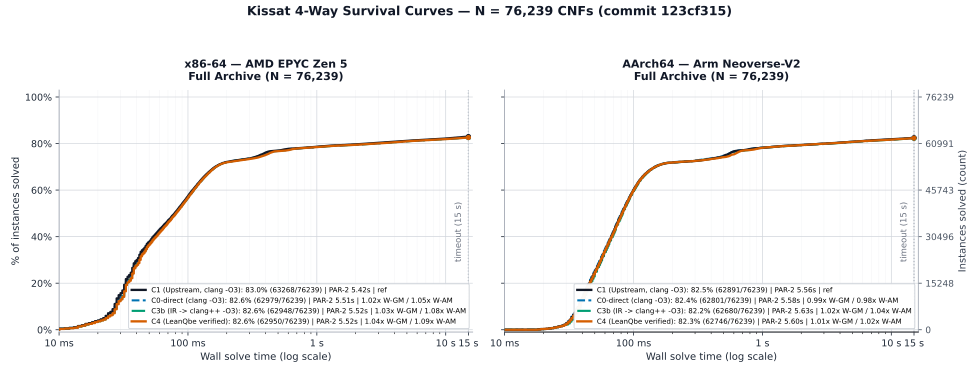

# LeanQbe.T

**LeanQbe.T** is a formally verified optimizing compiler written in Lean 4. It compiles typed
Static Single Assignment (SSA) programs—from extended C0, Lean `LCNF`, WebAssembly,
and Bedrock2 frontends—to native **SysV x86-64** and **AAPCS64 AArch64** assembly (as well as
QBE IL and C++20), with semantic preservation proved inside Lean's kernel down to the Kraken
instruction AST (pre-assembly; see [Trusted Computing Base](#trusted-computing-base-tcb--non-vacuity)).

Machine-code correctness proofs compose through **Kraken** ([README.md](README.md)),
which formalizes x86-64 (`Kraken.X64`) and AArch64 (`Kraken.AArch64`) instruction semantics in
separation logic under a synthetic uniform 4-byte instruction layout (`x64UniformLayout` /
`armUniformLayout`), prior to text printing (including `.p2align` padding) and host
assembly/linking. All verified theorems in the main `LeanQbe` library depend only on Lean 4's
three standard axioms (`propext`, `Classical.choice`, `Quot.sound` — `std3`), with zero `sorry`,
zero custom trust axioms, and zero native-code reflection tactics (`native_decide`, `bv_decide`,
`ofReduceBool`). The separate, experimental [`bv_decide_qbe`](#verified-bitblaster--experimental-bv_decide_qbe)
package is the one place that deliberately trusts a native run, and documents that boundary
explicitly.

```text
  Frontends                        Typed SSA / Flat IR                     Backends (Kraken ISAs)
  ─────────────────────────────    ────────────────────────────────────    ──────────────────────────
  Extended C0 (structs, macros,    ┌──────────────────────────────────┐    ┌────────────────────────┐
    slab layouts, templates)       │ LeanQbe.T PHOAS / First-Order IR │───▶│ SysV x86-64 (+AVX2/512)│
  Lean LCNF + C0 runtime & FFI ───▶│  WP separation-logic semantics   │    │ AAPCS64 AArch64        │
  WebAssembly (SFI sandbox)        │  earlyOpt → legal → mid → spill  │    │ QBE IL / C++20 output  │
  Bedrock2 (CFG recovery)          │  → graph-coloring rega → link    │    └────────────────────────┘
                                   └──────────────────────────────────┘
```

---

## Verification Status at a Glance

The table below distinguishes components that are **verified end-to-end on `main`** from active
work in progress. Every verified track has self-contained audit files under
[LeanQbeTest/T/](LeanQbeTest/T/) restating its exact theorems and Trusted Computing Base (TCB).

| Component | Status on `main` | What Is Proved Inside Lean's Kernel (`≤ std3`) |
| :--- | :--- | :--- |
| **Optimizing Compiler & Linker** | **Verified (dual-arch)** | Semantic preservation from typed SSA (`Func.wp` / `ModuleOk`) through flat-IR optimization (`MainFlat`), legalization, spilling, register allocation, instruction selection, and acyclic/SCC/segmented certificate linking (`LinkedCert`) down to Kraken x86-64 and AArch64 directive ASTs (pre-assembly). |
| **Extended C0 Frontend, Logic, & Extensions** | **Verified** | Untrusted C0-to-SSA elaboration with proved output well-formedness (`TFlatFn.toFn_wf`), SysV LP64 struct/bitfield layout, symbolic separation-logic stepping tactics (`C0Step`, `C0HeadStep`), unaligned byte & slab-layout automation (`BytesUnaligned`, `c0_slab_layout!`), and static PHOAS C0 templates (`c0_fn_template!`, `#unroll`) proved sound against `Func.wp`. |
| **Lean `LCNF`: Runtime, Semantics, End-to-End Compilation, & FFI** | **Verified (dual-arch)** | Pure-C0 runtime (`rtC0CoreMod`) with materialized dual-arch `LinkedCert`s ([LcnfC0FullCertX64.lean](LeanQbe/T/Amd64/LcnfC0FullCertX64.lean), [LcnfC0FullCertArm64.lean](LeanQbe/T/Arm64/LcnfC0FullCertArm64.lean); `≤ 272 B` stack; float primitives external); pure (`Sem/P`) and heap/RC (`Sem/H`) semantics linked by Perceus (`perceus_sound`) and lowering soundness (`lowerModule_moduleOk`); target-parametric Lean-to-machine-code theorems (`lean_fn_compiled_{acyclic,loop,scc}`) instantiated on both ISAs; and a zero-axiom C0 FFI bridge (`LcnfC0Ffi`). |
| **WebAssembly Sandbox** | **Verified (dual-arch)** | Software Fault Isolation (SFI) host-memory isolation across validated Wasm modules (including bulk-memory ops and mutual recursion) on x86-64 and AArch64. |
| **Bedrock2 CFG Recovery & `Xcap` Interop** | **Verified (dual-arch)** | Witness-checked CFG recovery and contification over structured `BedrockWord` programs; bidirectional `FnSpec` ↔ `Xcap.cptr` bridge for cross-calls with externally verified assembly. |
| **Systems Kernels & LRAT Checker** | **Verified (dual-arch)** | Machine-code proofs (to Kraken AST) and concrete execution witnesses for RFC 8439 ChaCha20 (row-SIMD `v4i32`), Curve25519 bignum kernels, Union-Find, and an untrusted-bytes DIMACS + binary LRAT UNSAT checker (`lrat_check_bytes`). |
| **Verified Dual-Arch Kissat 4.0.4 (`418` C0 fns)** | **Verified (dual-arch, UNSAT)** | Clean 4-pillar pure-C0 port of Kissat 4.0.4 (`41` C0 modules, `418` functions, `0` externs, `0` exits) with full CDCL + inprocessing: `ModuleOk` & UNSAT soundness (`XPost := False`, `r = 20#64 → cnf.Unsat`) + concrete `Mem 64` UNSAT non-vacuity (`Proof/Full.lean`, `Proof/FullNv.lean`), permanent segmented dual-arch materialized compiler certificates (`Build/{Amd64,Arm64}/Full.lean`, `≤ 2,048 B` stack), and dual-arch machine-code UNSAT soundness & closed-host non-vacuity (`T/{Amd64,Arm64}/KissatFidelityParam.lean`). Zero SAT model proofs inside Lean (SAT answers checked externally in CLI). |
| **Kissat Minimal CDCL (`KissatPlain`)** | **Verified (dual-arch, SAT + UNSAT)** | Pure CDCL solver (`plainModule`, entry point `kissat_solve_bytes`) with **dual SAT + UNSAT** soundness, materialized x86-64 & AArch64 `LinkedCert`s (`plainCert`), and concrete machine SAT/UNSAT non-vacuity (`2,048 B` workspace). |
| **Simplified-CNF Exporter (`ExportCnf`)** | **Source/IR verified** | Pure-C0 simplifier and DIMACS serializer (`exportCnfEntryMod`, entry point `kissat_simplify_export_bytes`): grammar round-trip (`parseDimacs outBytes = some cnfOut`), UNSAT soundness (`cnfOut.Unsat → F0.Unsat`), and concrete `Mem 64` non-vacuity. |
| **ARiSCA Multiplier Checker (`44` C0 fns)** | **Verified (dual-arch)** | Kernel-executable ART v1 / AIGER multiplier checker (`checkArt_sound`, `checkArtB_sound`) plus a `44`-function pure-C0 port (`arisca_check_bytes`, `0` externs, `0` exits) with full WP soundness (`XPost := False`), materialized x86-64 (`656 B` stack) and AArch64 (`624 B` stack) `LinkedCert`s, machine-code soundness (`AR_ACCEPT = 20#64` implies modular multiplier equivalence), and concrete `Mem 64` non-vacuity ([Amd64/Arisca.lean](LeanQbe/T/Amd64/Arisca.lean), [Arm64/Arisca.lean](LeanQbe/T/Arm64/Arisca.lean), [Arisca/Proof/CertBridge.lean](LeanQbe/T/Examples/Arisca/Proof/CertBridge.lean)). |
| **Bitblaster (`bv_solve_bytes`)** | **Verified (dual-arch)** | C0 And-Inverter Graph builder, Tseitin encoder, and driver (`bitblastModule`) covering all `32` `BVP1` opcodes, proved against Lean's `BVLogicalExpr.Unsat` (`bitblast_moduleOk`, `bv_solve_bytes_unsat_wp`); linked with `KissatPlain` into closed dual-arch `LinkedCert`s and parameterized over any `KissatUnsatPkg` (including full-fidelity Kissat) in `BitblastFidelityParam`. |
| **`bv_decide_qbe` Tactic** | **Experimental (trusts a native run)** | Not a kernel proof: runs `bv_solve_bytes` + full-fidelity Kissat in-process (`upstream` or `enhanced` preset) via an encapsulated FFI boundary and records each UNSAT answer as one per-goal axiom (`_leanqbe.bv_solve.ax`). Passes `59/59` applicable upstream `bv_decide` compare files (`.upstream`: `0.952× W-AM`, `.enhanced`: `0.987× W-AM`). Trusts the thin C FFI shim, word packing, axiom construction, and native execution. |
| **Stage-0 Bootstrap (`LeanQbeBootstrap0`)** | **Work in progress** | Syntactic x86-64 `LinkedCert` (`leanqbe0Cert`, `≤ 1,136 B ≤ 2,048 B` stack) compiling `leanqbe0Mod0` (extracted from `leanqbe0Compile`) and linking it with `rtC0CoreCert` into `leanqbe0LinkedCert` (`nX = 64` for `lcnf_panic`), plus separate scalar soundness, codec, and printer checks. Extraction is outside the kernel and no self-hosted semantic fixpoint is proved. |

---

## Quick Start & Contributor Workflow

All Lean builds should use [scripts/build_bounded.sh](scripts/build_bounded.sh), which wraps `lake
build --wfail` in a `systemd` memory cgroup (`MemoryMax=18G`, swap disabled), thread cap (`-j 1`),
and explicit timeout (`-t 600`). By default it rejects umbrella targets (`LeanQbe`,
`LeanQbeAmd64`, `LeanQbeArm64`, `LeanQbeTest`, `LeanQbeBootstrap0*`) so iterations target concrete
modules or fine-grained core libraries (`LeanQbeCore`, `LeanQbeAmd64Core`, `LeanQbeArm64Core`,
`LeanQbeCompileGuards`); pass `--allow-broad` when an umbrella build is intentional.

```bash
# 1. Fast preflight (<30s: diff whitespace, ISA import firewall, hub sync, changed-.lean hygiene)
bash scripts/preflight.sh

# 2. Build a specific audit target or core library under bounded memory/threads
scripts/build_bounded.sh -j 1 -m 18G -t 600 -- LeanQbeTest.T.CompilerAuditSpec
scripts/build_bounded.sh -j 2 -m 18G -t 600 -- LeanQbeCore

# 3. Build the native x86-64 and AArch64 CLI drivers
scripts/build_bounded.sh -j 2 -m 18G -t 600 -- leanqbe leanqbe-arm64

# 4. Inspect built-in programs and emit assembly or QBE IL
.lake/build/bin/leanqbe --list
.lake/build/bin/leanqbe uf_bench > /tmp/uf.s
.lake/build/bin/leanqbe --il uf_bench > /tmp/uf.ssa
.lake/build/bin/leanqbe-arm64 uf_bench > /tmp/uf_arm64.s

# 5. Run the full quality gate (build, axiom audit via audit_axioms, headlines, native tests)
timeout 3600 bash scripts/check.sh

# Incremental / docs-only scoped gate (auto-selects docs-only, reverse-dep fast lane, per-ISA, or full)
timeout 120 env CHECK_SCOPE=auto CHECK_BASE=HEAD~1 bash scripts/check.sh
```

**Contributor hygiene rules** (enforced by [scripts/preflight.sh](scripts/preflight.sh) and
[scripts/check.sh](scripts/check.sh)):
- **Standard axioms only (`≤ std3`):** Active theorems must depend strictly on `[propext,
  Classical.choice, Quot.sound]` (`!isUnsafe`), audited on `.olean` files by `audit_axioms`; zero
  `sorry`, `admit`, non-meta `axiom`, `@[implemented_by]`, `@[extern]`, `trustCompiler`, or native
  reflection tactics.
- **ISA import firewall & hub sync:** Generic `LeanQbe/T/` modules never import `Kraken.X64` or
  `Kraken.AArch64`, and [LeanQbeAmd64.lean](LeanQbeAmd64.lean) / [LeanQbeArm64.lean](LeanQbeArm64.lean)
  stay strictly disjoint (`python3 -B scripts/check_firewall.py --root . --require-isa`). After
  adding or removing `.lean` modules under `LeanQbe/T/`, synchronize hubs with
  `python3 -B scripts/sync_hubs.py --root .` and verify with `--check --strict`.
- **File, import, & test discipline:** Never use `import all`; keep `.lean` files `< 2,500` lines
  and `<= 100` chars/line; always run test commands under explicit `timeout`.

---

## Architecture & Pipeline

### 1. Typed SSA IR & Weakest-Precondition Semantics
- **Dual Representations:** Programs are written in typed Parametric Higher-Order Abstract Syntax
  (PHOAS: `Prog` / `Func` / `Fn` in [IL.lean](LeanQbe/T/IL.lean)) alongside a first-order de Bruijn
  flat form ([Flat.lean](LeanQbe/T/Flat.lean)).
- **Total-Correctness WP Semantics:** [WP.lean](LeanQbe/T/WP.lean) defines weakest preconditions
  (`wp`, `Func.wp`, `ModuleOk`) over 64-bit byte-addressed memory (`Mem 64`) and separation-logic
  assertions (`⋆`, `region`, `array`, `cell`), guaranteeing explicit postconditions for normal
  returns (`Post`), abnormal exits (`XPost`), and untouched caller memory frames (`R`).

### 2. Frontends, C0 Extensions, & Interoperability
- **Extended C0 Frontend & Extensions ([Frontend/C0.lean](LeanQbe/T/Frontend/C0.lean)):**
  - *Core C0 Elaborator & Logic:* Untrusted, shape-stable elaborator for a structured C subset with
    `#include` headers (`c0_header!`), parameterized and variadic `#define` macros, `offsetof`,
    `_Static_assert`, provenance checks, and SysV LP64 struct/bitfield layout, with proved output
    well-formedness (`TFlatFn.toFn_wf`) and symbolic separation-logic stepping tactics
    ([C0Step.lean](LeanQbe/T/Logic/C0Step.lean), [C0HeadStep.lean](LeanQbe/T/Logic/C0HeadStep.lean)).
  - *Layout & Unaligned Bytes (`LayoutBytes`):* The `c0_slab_layout!` DSL
    ([SlabLayoutElab.lean](LeanQbe/T/Logic/SlabLayoutElab.lean)) generates static and parametric
    slab layouts (`to_region`, `of_region_frame`, typed field loads/stores, lenses), paired with
    unaligned little-endian `u16`/`u32`/`u64` loads and stores over byte slices
    ([BytesUnaligned.lean](LeanQbe/T/Logic/BytesUnaligned.lean); tested in
    [C0ProtoLayoutBytesTest.lean](LeanQbeTest/T/C0ProtoLayoutBytesTest.lean)).
  - *Static PHOAS C0 Templates (`Templates`):* `c0_fn_template!`, `c0_expr_template!`,
    `c0_stmt_template!`, and `#unroll`
    ([Template/Snippet.lean](LeanQbe/T/Frontend/C0/Template/Snippet.lean),
    [Template/Wp.lean](LeanQbe/T/Frontend/C0/Template/Wp.lean),
    [Template/Elab.lean](LeanQbe/T/Frontend/C0/Template/Elab.lean)) support value, width/type,
    operator, and code splices so parametric WP proofs can be proved once across widths, ops, and
    compile-time lists (tested in
    [C0ProtoTemplatesTest.lean](LeanQbeTest/T/C0ProtoTemplatesTest.lean),
    [C0ProtoTemplatesX64Test.lean](LeanQbeTest/T/C0ProtoTemplatesX64Test.lean), and
    [C0ProtoTemplatesArm64Test.lean](LeanQbeTest/T/C0ProtoTemplatesArm64Test.lean)).
- **Lean `LCNF` Frontend, Runtime, Semantics, & FFI ([LeanLCNF/Hub.lean](LeanQbe/T/LeanLCNF/Hub.lean)):**
  - *Standalone C0 Runtime:* [LcnfC0Full.lean](LeanQbe/T/LeanLCNF/LcnfC0Full.lean) implements
    `rtC0CoreMod` in verified pure C0 (heap allocator, reference counting, arbitrary-precision
    `BigNum`, containers, strings). It covers every non-floating-point runtime entry point (only
    `lcnf_float_{bin,un,of_sci}` remain external) and has verified SysV x86-64
    ([LcnfC0FullCertX64.lean](LeanQbe/T/Amd64/LcnfC0FullCertX64.lean)) and AAPCS64 AArch64
    ([LcnfC0FullCertArm64.lean](LeanQbe/T/Arm64/LcnfC0FullCertArm64.lean)) `LinkedCert`s
    (`≤ 272 B` stack) with closed concrete machine execution witnesses.
  - *Two-Tier Formal Semantics:* A pure value-level semantics
    ([Sem/P.lean](LeanQbe/T/LeanLCNF/Sem/P.lean)) and a heap/reference-counting semantics
    ([Sem/H.lean](LeanQbe/T/LeanLCNF/Sem/H.lean)), with a decidable ownership checker
    ([Sem/RcCheck.lean](LeanQbe/T/LeanLCNF/Sem/RcCheck.lean)). Perceus soundness
    ([Sem/Perceus.lean](LeanQbe/T/LeanLCNF/Sem/Perceus.lean): `perceus_sound`, `perceus_sound_idx`)
    shows that any `RcCheck`-accepted module satisfying a pure spec also satisfies the
    corresponding heap/RC spec, and lowering soundness
    ([Sem/LowerSound4.lean](LeanQbe/T/LeanLCNF/Sem/LowerSound4.lean): `lowerModule_moduleOk`)
    carries that spec down to the compiler's typed SSA.
  - *End-to-End Lean-to-Machine-Code Theorems:* [Sem/E2E.lean](LeanQbe/T/LeanLCNF/Sem/E2E.lean)
    composes these layers with runtime certificate linking into target-parametric theorems
    (`lean_fn_compiled_acyclic`, `lean_fn_compiled_loop`, `lean_fn_compiled_scc`) for first-order
    Lean functions; [Sem/Tactic.lean](LeanQbe/T/LeanLCNF/Sem/Tactic.lean) provides `lcnf_sim` /
    `lcnf_res_sim` for discharging the pure-level obligations. In
    [LcnfE2EDemos.lean](LeanQbeTest/T/LcnfE2EDemos.lean), Lean definitions (`addNat`, `factAcc`,
    `listSum`, `treeSum`, `treeSize`) are extracted, compiled, and proved—without any hand-written
    heap-level or SSA-level WP—to return what the original Lean function returns (under stated size
    bounds, relative to out-of-kernel extraction via `lcnf_of_lean!` / `splice_lcnf_tflat!` and
    `Sem/P` adequacy, with `lcnf_float_{bin,un,of_sci}` external and `lcnf_panic` unmodeled), with
    concrete x86-64 and AArch64 instances in
    [LcnfE2ECertX64.lean](LeanQbeTest/T/LcnfE2ECertX64.lean) and
    [LcnfE2ECertArm64.lean](LeanQbeTest/T/LcnfE2ECertArm64.lean).
  - *Zero-Axiom C0 FFI Bridge:* [LcnfC0Ffi.lean](LeanQbe/T/LeanLCNF/LcnfC0Ffi.lean) lets lowered
    Lean `LCNF` code call verified raw-byte-slice C0 kernels via `ByteArray` or sentineled `Nat`
    carriers without `@[extern]` or custom axioms, demonstrated end-to-end by closed dual-arch
    pilot binaries (`pilotX64Cert` / `pilotArm64Cert`, composing `KissatPlain`, `rtC0CoreMod`, and
    lowered Lean callers without recompiling Kissat or the runtime) in
    [LcnfC0FfiPilotCertX64.lean](LeanQbeTest/T/LcnfC0FfiPilotCertX64.lean) and
    [LcnfC0FfiPilotCertArm64.lean](LeanQbeTest/T/LcnfC0FfiPilotCertArm64.lean).
- **WebAssembly SFI Sandbox ([Wasm/Safety.lean](LeanQbe/T/Wasm/Safety.lean),
  [Wasm/BulkSafety.lean](LeanQbe/T/Wasm/BulkSafety.lean)):** Decodes, validates, and compiles Wasm
  modules (including bulk-memory operations) with proved Software Fault Isolation host-memory
  bounds across arbitrary call graphs (`ModuleSccOk`).
- **Bedrock2 CFG Recovery ([Bedrock2/ToT.lean](LeanQbe/T/Bedrock2/ToT.lean),
  [CfgRecovery.lean](LeanQbe/T/Unified/CfgRecovery.lean),
  [CfgContify.lean](LeanQbe/T/Unified/CfgContify.lean)):** Lowers structured `BedrockWord` programs
  via witness-checked CFG recovery and contification.
- **External Assembly Interop ([Xcap/Bridge.lean](LeanQbe/T/Xcap/Bridge.lean)):** Converts compiled
  `FnSpec` guarantees to and from Certified Assembly Programming (`Xcap.cptr`) code pointers for
  verified cross-calls with externally proved assembly blocks.

### 3. Verified Optimization, Codegen, & Certificate Linking
`LeanQbe.T.compile` ([Main.lean](LeanQbe/T/Main.lean), [Opt.lean](LeanQbe/T/Opt.lean)) runs a
target-parameterized pipeline, mirrored by a direct first-order flat-IR pipeline
([MainFlat.lean](LeanQbe/T/MainFlat.lean), which runs natively on the flat IR without PHOAS
round-trips and is proved equal via `compileFlatFn_eq_compileFn`) and first-order/segmented
certificate linking ([MainCertFlat.lean](LeanQbe/T/MainCertFlat.lean),
[MainCertSeg.lean](LeanQbe/T/MainCertSeg.lean)):

1. **Early Optimization (`Func.earlyOpt`):** Constant folding, algebraic simplification, operator
   canonicalization, copy propagation, global value numbering (GVN), branch/switch and boolean
   simplification (`IfOpt`, including sinking single-use compares next to the `select` that
   consumes them), loop-header and zero-trip peeling (`ZeroPeel` with `u32` IV widening), and
   dead-code / parameter pruning (`DceParam`).
2. **Legalization (`Func.legal`, [Legal.lean](LeanQbe/T/Legal.lean)):** Rewrites constants, widths,
   addressing modes, and instructions to satisfy each target's `LegalTarget` contract.
3. **Mid-Stage & Late Optimization (`Fn.midStage` / `Func.lateOpt`):** Constant-division strength
   reduction, redundant load forwarding, range and bitwidth assumption propagation, dead-load and
   base+offset address-range elimination (`AddrRangeOpt`, which on AArch64 also folds a loop's
   unique displacement into the hoisted base address), loop-invariant code motion (LICM),
   bottom-tested loop rotation, conditional threading across wide boolean block parameters
   (`CondThreadOpt`), tail duplication, and shared epilogue merging.
4. **Spilling, Register Allocation, & Emission (`Spill.lean`, `Rega.lean`, `Amd64/`, `Arm64/`):**
   Control-flow-preserving spill/reload hinting (with flag-web tracking and base+offset
   rematerialization), graph-coloring GPR/vector allocation, ABI frame lowering, unique `.L` label
   hygiene (`LabelClean`), and target emission into `Kraken.X64` (scalar + AVX2/AVX-512) or
   `Kraken.AArch64`. Heuristic passes (spill-slot coalescing, loop-invariant register promotion,
   loop-constant hoisting, zero-extension facts) are untrusted: they only produce hints that the
   verified allocator checks before use. AArch64 instruction selection additionally uses
   shifted-register ALU and compare operands, sign-extending narrow loads fused into compares
   (`LDRSB` / `LDRSH`), in-block address CSE, zero-extension elision, load narrowing, reuse of
   already-materialized constants, high-half multiplies (`UMULH` / `SMULH`), conditional compares
   (`CCMP` / `CCMN`) for flag-chained short-circuit compares, and conditional negation (`CSNEG`).
5. **Cross-ISA Isolation & Compositional Linking:** Machine-independent modules never import
   `Kraken.X64` or `Kraken.AArch64`, and [LeanQbeAmd64.lean](LeanQbeAmd64.lean) and
   [LeanQbeArm64.lean](LeanQbeArm64.lean) are strictly disjoint (enforced by
   [scripts/check_firewall.py](scripts/check_firewall.py)).
   [MainCertCore.lean](LeanQbe/T/MainCertCore.lean) and
   [MainCertSeg.lean](LeanQbe/T/MainCertSeg.lean) define kernel-checked `LinkedCert` and
   subsystem-segmented `SegChunks` artifacts that compose across modules, mutual recursion, and
   least fixed points ([MainLink.lean](LeanQbe/T/MainLink.lean),
   [LinkRec.lean](LeanQbe/T/LinkRec.lean), [LinkScc.lean](LeanQbe/T/LinkScc.lean),
   [LinkLfp.lean](LeanQbe/T/LinkLfp.lean)).

---

## Verified Systems Workloads, ARiSCA, & Kissat 4.0.4

Alongside smaller verified systems kernels—RFC 8439 **ChaCha20**
([ChaCha.lean](LeanQbe/T/Examples/ChaCha.lean)), **Curve25519** bignum arithmetic
([Bignum.lean](LeanQbe/T/Examples/Bignum.lean)), **Union-Find**
([UnionFind.lean](LeanQbe/T/Examples/UnionFind.lean)), and an untrusted-bytes DIMACS + binary
**LRAT** UNSAT proof checker (`lrat_check_bytes`,
[LratBytes.lean](LeanQbe/T/Examples/LratBytes.lean))—the repository contains two larger verified
dual-architecture applications: an end-to-end verified **ARiSCA** multiplier checker and a
pure-C0 port of the **Kissat 4.0.4** CDCL SAT solver (`0` external calls, `0` exit symbols).

### End-to-End Verified Dual-Arch ARiSCA (`44` C0 Functions)

[ArtCore.lean](LeanQbe/T/Examples/Arisca/ArtCore.lean) defines a checker for ART v1 algebraic
rewriting traces certifying that a binary AIGER circuit computes a signed or unsigned
multiplication, with kernel-executable soundness (`checkArt_sound` in
[ArtSound.lean](LeanQbe/T/Examples/Arisca/ArtSound.lean) and `checkArtB_sound` in
[ArtSoundB.lean](LeanQbe/T/Examples/Arisca/ArtSoundB.lean); exercised in
[AriscaTest.lean](LeanQbeTest/T/AriscaTest.lean) on a 4-bit unsigned array multiplier, an 8-bit
signed Booth multiplier, and a truncated-trace rejection test).

Building on that specification, [Arisca/Src/Module.lean](LeanQbe/T/Examples/Arisca/Src/Module.lean)
implements `ariscaModule` (`44` pure-C0 functions, `0` externs, `0` exits, entry point
`arisca_check_bytes`), verified end-to-end on both architectures (`≤ std3`):
- **Source/IR WP & arch-free bridge:** [Arisca/Proof/Full.lean](LeanQbe/T/Examples/Arisca/Proof/Full.lean)
  proves `ariscaModule_ok` and `arisca_check_bytes_sound` (`XPost := False`, matching
  `ArtSound.checkArt_sound`) plus concrete `Mem 64` non-vacuity;
  [Arisca/Proof/CertBridge.lean](LeanQbe/T/Examples/Arisca/Proof/CertBridge.lean) lifts those
  guarantees parametrically over any `BenchAbi` `LinkedCert`.
- **Materialized dual-arch machine-code soundness:**
  [Amd64/Arisca.lean](LeanQbe/T/Amd64/Arisca.lean) (`ariscaX64Cert`, `656 B` entry stack bound,
  `check_bytes_x64_correct`, `check_bytes_x64_sound`, `x64_nonvacuous`) and
  [Arm64/Arisca.lean](LeanQbe/T/Arm64/Arisca.lean) (`ariscaArm64Cert`, `624 B` entry stack bound,
  `check_bytes_arm64_correct`, `check_bytes_arm64_sound`, `arm64_nonvacuous`) prove that returning
  `AR_ACCEPT = 20#64` (`rax = 20#64` / `X0 = 20#64`) implies `parseAig` succeeds and the circuit's
  output equals the product of its inputs modulo `2^|O|`, with callee-saved register, stack-pointer,
  and `Mem 64` framing preserved (audited in
  [AriscaCertX64Test.lean](LeanQbeTest/T/AriscaCertX64Test.lean) and
  [AriscaCertArm64Test.lean](LeanQbeTest/T/AriscaCertArm64Test.lean)).

### Verified Dual-Arch Kissat 4.0.4 (`418` C0 Functions)

The full-fidelity Kissat 4.0.4 port under [LeanQbe/T/Examples/Kissat/](LeanQbe/T/Examples/Kissat/)
is organized into four clean, decoupled pillars (`≤ std3`, `0` externs, `0` exits):

1. **Reference Specifications (`Kissat/Ref/`):** `19` modules of pure functional definitions for
   CDCL, chronological backtracking, clause reduction, minimization/shrinking, congruence,
   sweeping, BVE, and factoring, with **0 proofs** (`0` `theorem`/`lemma` declarations) so specs
   stay readable and lightweight to import.
2. **Pure-C0 Solver Source (`Kissat/Src/`):** `41` upstream-mirrored C0 modules assembled flat in
   [Src/Full.lean](LeanQbe/T/Examples/Kissat/Src/Full.lean) (`kissatModule`, `418` live functions,
   `0` dead slots, kernel-verified `kissatModule_wf` and acyclicity), plus the inlining policy in
   [Src/InlPolicy.lean](LeanQbe/T/Examples/Kissat/Src/InlPolicy.lean).
3. **Weakest-Precondition Proofs (`Kissat/Proof/`):** Per-subsystem WP proofs across all `41`
   modules assembled over a flat canonical environment in
   [Proof/Full.lean](LeanQbe/T/Examples/Kissat/Proof/Full.lean) (`full_moduleOk`, `kissatUnsatPkg`,
   `full_solve_bytes_sound` with `XPost := False` and `r = 20#64 → ∃ cnf, parseDimacs cnfBytes = some cnf ∧ cnf.Unsat`)
   and concrete `Mem 64` UNSAT non-vacuity in
   [Proof/FullNv.lean](LeanQbe/T/Examples/Kissat/Proof/FullNv.lean) (`full_unsat_nv` on an `8,192 B`
   workspace). Zero SAT model proofs are proved inside
   Lean; SAT answers are verified at runtime in the CLI.
4. **Segmented Dual-Arch Certificates & Machine-Code Soundness (`Kissat/Build/` + `T/{Amd64,Arm64}/`):**
   Permanent subsystem-segmented compiler certificates materialized on both ISAs in
   [Build/Amd64/Full.lean](LeanQbe/T/Examples/Kissat/Build/Amd64/Full.lean) and
   [Build/Arm64/Full.lean](LeanQbe/T/Examples/Kissat/Build/Arm64/Full.lean) (`fullCert`, `≤ 2,048 B`
   stack over the inlined plan in [Build/Inl/Full.lean](LeanQbe/T/Examples/Kissat/Build/Inl/Full.lean)),
   paired with dual-arch machine-code UNSAT soundness, ABI/memory framing, and closed-host `Mem 64`
   UNSAT non-vacuity theorems in
   [Amd64/KissatFidelityParam.lean](LeanQbe/T/Amd64/KissatFidelityParam.lean) and
   [Arm64/KissatFidelityParam.lean](LeanQbe/T/Arm64/KissatFidelityParam.lean) (audited in
   [KissatFidelityParamAuditX64.lean](LeanQbeTest/T/KissatFidelityParamAuditX64.lean),
   [KissatFidelityParamAuditArm64.lean](LeanQbeTest/T/KissatFidelityParamAuditArm64.lean),
   [KissatFidelityCompileGuardX64.lean](LeanQbeTest/T/KissatFidelityCompileGuardX64.lean), and
   [KissatFidelityCompileGuardArm64.lean](LeanQbeTest/T/KissatFidelityCompileGuardArm64.lean)).

### Solver Tracks & Simplified-CNF Exporter

| Track | Module & Entry Point | Soundness Scope | Architecture Verification | Primary Audits |
| :--- | :--- | :--- | :--- | :--- |
| **Full-Fidelity Kissat 4.0.4** | `Src.Full.kissatModule` (`418` fns, `kissat_solve_bytes`) | UNSAT soundness (`XPost := False`, `r = 20#64 → cnf.Unsat`; zero SAT model proofs) + caller memory framing + concrete `Mem 64` UNSAT non-vacuity | `41`-module WP `ModuleOk` ([Proof/Full.lean](LeanQbe/T/Examples/Kissat/Proof/Full.lean), [Proof/FullNv.lean](LeanQbe/T/Examples/Kissat/Proof/FullNv.lean)); materialized segmented dual-arch `LinkedCert`s ([Build/Amd64/Full.lean](LeanQbe/T/Examples/Kissat/Build/Amd64/Full.lean), [Build/Arm64/Full.lean](LeanQbe/T/Examples/Kissat/Build/Arm64/Full.lean), `≤ 2,048 B` stack); dual-arch machine-code UNSAT theorems ([Amd64/KissatFidelityParam.lean](LeanQbe/T/Amd64/KissatFidelityParam.lean), [Arm64/KissatFidelityParam.lean](LeanQbe/T/Arm64/KissatFidelityParam.lean)) | [KissatSrcPostludeTest.lean](LeanQbeTest/T/KissatSrcPostludeTest.lean), [KissatLayerAFullTest.lean](LeanQbeTest/T/KissatLayerAFullTest.lean), [KissatFidelityParamAuditX64.lean](LeanQbeTest/T/KissatFidelityParamAuditX64.lean), [KissatFidelityParamAuditArm64.lean](LeanQbeTest/T/KissatFidelityParamAuditArm64.lean), [KissatFidelityCompileGuardX64.lean](LeanQbeTest/T/KissatFidelityCompileGuardX64.lean), [KissatFidelityCompileGuardArm64.lean](LeanQbeTest/T/KissatFidelityCompileGuardArm64.lean) |
| **Minimal CDCL (`KissatPlain`)** | `plainModule` (`kissat_solve_bytes`) | **Dual SAT + UNSAT** soundness + framing + concrete SAT & UNSAT non-vacuity (`2,048 B`) | Materialized x86-64 & AArch64 `LinkedCert`s (`plainCert`) with closed concrete machine execution witnesses (pure CDCL, no inprocessing) | [KissatPlainAuditX64.lean](LeanQbeTest/T/KissatPlainAuditX64.lean), [KissatPlainAuditArm64.lean](LeanQbeTest/T/KissatPlainAuditArm64.lean) |
| **Simplified-CNF Exporter (`ExportCnf`)** | `exportCnfEntryMod` (`kissat_simplify_export_bytes`) | DIMACS parse round-trip (`parseDimacs outBytes = some cnfOut`) + UNSAT preservation (`cnfOut.Unsat → F0.Unsat`) + concrete `Mem 64` non-vacuity | Source/IR `ModuleOk` + WP proofs, legal across x86-64 & AArch64 | [ExportCnfEntryTest.lean](LeanQbeTest/T/ExportCnfEntryTest.lean) |

### Building and Running the Native Solver

```bash
# Build certified native x86-64 KissatPlain binary (also supports --arch arm64)
timeout 600 bash bench/kissat/build_solver.sh --module Plain

# Build native Full-Fidelity Kissat binary (pass --allow-uncertified if emitting outside a top-level CLI cert wrapper)
timeout 600 bash bench/kissat/build_solver.sh --module KissatFidelity --allow-uncertified

# Run solver verification suites and CLI wrapper checks
timeout 600 bash test/kissat/run.sh
timeout 600 bash test/kissat/test_cli_solver.sh

# Extract standalone C99 source from the verified C0 solver (--target fidelity | plain)
python3 bench/kissat/extract_c0_direct.py --target fidelity --out /tmp/kissat_c0.c
```

### Trusted Computing Base (TCB) & Non-Vacuity

- **Proved Inside Lean (`≤ std3`: `[propext, Classical.choice, Quot.sound]`):** SSA well-formedness
  of elaborated C0 (`TFlatFn.toFn_wf`), WP correctness of C0/IR programs, SSA optimization,
  spilling, register allocation, instruction selection, certificate linking down to Kraken
  directive ASTs, UNSAT soundness for full-fidelity Kissat (plus SAT soundness for `KissatPlain`),
  multiplier equivalence for ARiSCA, bitblaster UNSAT soundness for `bv_solve_bytes`, and concrete
  `Mem 64` non-vacuity witnesses confirming that preconditions are satisfiable.
- **Outside Lean (TCB & Scope Boundaries):**
  - **C0 → SSA frontend & `LCNF` extraction:** The C0 parser, preprocessor, and C0-to-SSA lowering
    ([Frontend/C0/](LeanQbe/T/Frontend/C0/)) are untrusted: WP proofs are established directly over
    the elaborated `LeanQbe.T` SSA IR rather than against a separate mechanized C operational
    semantics. Similarly, Lean `LCNF` extraction (`lcnf_of_lean!` / `splice_lcnf_tflat!`) runs
    outside the proof kernel, `lcnf_float_{bin,un,of_sci}` remain external, and `lcnf_panic` is an
    unmodeled exit symbol.
  - **Lean 4 kernel & Kraken ISA models:** Hand-written operational semantics (`Kraken.X64`,
    `Kraken.AArch64`), not yet validated against Intel XED, the ARM ASL specification, or hardware
    co-simulation.
  - **Synthetic 4-byte layout, text printing, & host assembler/linker encoding:** Machine-code
    theorems are proved on Kraken directive ASTs under a uniform 4-byte instruction layout
    (`x64UniformLayout` / `armUniformLayout`, `instrSize _ := 4`), not on variable-length encoded
    bytes. Assembly text printing (`toATTAligned` and AArch64 aligned printing, which inject
    `.p2align` padding outside the AST, plus `.globl`/`.note.GNU-stack` wrappers), the host
    assembler and linker (`cc`/`as`/`ld`), ELF relocation, and the OS loader are outside the
    kernel.
  - **`Mem 64` flat memory vs. OS process memory & stack:** WP proofs assume a flat, total 64-bit
    byte memory where precondition regions are mapped and unaliased; page faults, signals,
    concurrent threads, and `RLIMIT_STACK` are not modeled. Proved stack bounds (`≤ 2,048 B` for
    Kissat, `656 B` / `624 B` for ARiSCA, `≤ 272 B` for the `LCNF` runtime) hold on real hardware
    only if the host provides at least that much mapped stack.
  - **Thin C CLI/FFI shims & uncertified CLI emission flags:** The native CLI wrapper
    ([kissat_cli.c](bench/kissat/kissat_cli.c)) enforces `RLIMIT_STACK >= 65536` and brackets
    input/workspace buffers with `PROT_NONE` guard pages; the in-process `bv_decide_qbe` C FFI
    shim ([kissat_ffi.c](bv_decide_qbe/c/kissat_ffi.c)) relies on Lean's unchecked OS thread stack
    and exclusive ownership of its workspace `ByteArray`. Any build run with `--allow-uncertified`,
    `--inline-max > 0`, or `--debug` emits assembly outside a single closed top-level CLI
    certificate check (covered by compile-parametric `KissatFidelityParam` theorems when matching
    `compileModuleOptInlinePolicy`).
  - **Format specifications & UNSAT-only Kissat soundness:** The `parseDimacs` specification
    ([LratBytes.lean](LeanQbe/T/Examples/LratBytes.lean)) requires variables `< 2^28`, rejects `-0`,
    missing headers, out-of-range variables, truncated clauses, trailing non-whitespace tokens, and
    `%` trailers; skips `'c'` comment lines from any whitespace-delimited position; and treats
    empty clauses as UNSAT and `p cnf 0 0` as empty CNF. Likewise, ARiSCA soundness is stated with
    respect to `parseAig` and `outWord`/`inWord` in
    [ArtCore.lean](LeanQbe/T/Examples/Arisca/ArtCore.lean). For full-fidelity Kissat, **SAT model
    validity is not proved inside Lean** and is checked at runtime by `kissat_verify_dimacs_model`
    in [kissat_verify.h](test/kissat/kissat_verify.h); `KissatPlain` proves both SAT and UNSAT
    soundness inside Lean.

### Verified Bitblaster & Experimental `bv_decide_qbe`

- **Verified bitblaster (`32` C0 bitblasting ops):**
  [Bitblast/Src/Full.lean](LeanQbe/T/Examples/Bitblast/Src/Full.lean) and
  [Bitblast/Proof/Full.lean](LeanQbe/T/Examples/Bitblast/Proof/Full.lean) implement and verify a C0
  And-Inverter Graph (AIG) builder, Tseitin CNF encoder, and driver (`bitblastModule`, entry point
  `bv_solve_bytes`) covering all `32` `BVP1` opcodes (variables, constants, Boolean gates, `ite`,
  equality, bitwise ops, addition, multiplication, shifts, rotates, unsigned division/remainder,
  `clz`, and `cpop`) directly against Lean's upstream `Std.Tactic.BVDecide.BVLogicalExpr.Unsat`
  (`bitblast_moduleOk`, `bv_solve_bytes_unsat_wp`, `≤ std3`).
- **Machine code (to Kraken AST):** [BitblastCertX64.lean](LeanQbeTest/T/BitblastCertX64.lean) and
  [BitblastCertArm64.lean](LeanQbeTest/T/BitblastCertArm64.lean) link the bitblaster with
  `KissatPlain` (zero externs) and prove machine-code UNSAT soundness
  (`bitblast{X64,Arm64}_bv_solve_bytes_unsat_sound`) plus concrete non-vacuity.
  [Amd64/BitblastFidelityParam.lean](LeanQbe/T/Amd64/BitblastFidelityParam.lean) and
  [Arm64/BitblastFidelityParam.lean](LeanQbe/T/Arm64/BitblastFidelityParam.lean) prove the same
  guarantee parametrically over any `KissatUnsatPkg` (including full-fidelity Kissat), audited in
  [BitblastFidelityParamAuditX64.lean](LeanQbeTest/T/BitblastFidelityParamAuditX64.lean) and
  [BitblastFidelityParamAuditArm64.lean](LeanQbeTest/T/BitblastFidelityParamAuditArm64.lean).
- **`bv_decide_qbe` tactic (experimental, axiom-checked FFI):** `bv_decide_qbe/`
  ([Tactic.lean](bv_decide_qbe/BvDecideQbe/Tactic.lean)) is a separate Lake package providing a
  `bv_decide` alternative (also usable inside `sym =>` / `grind =>`, honoring `cfg.timeout`). It
  supports two execution presets—`enhanced` (default, adding conservative preprocessing such as
  automatic AC normalization for multiplications and fast simulation counterexample pre-checks) and
  `upstream` (`bv_decide_qbe_upstream`, `(mode := .upstream)`, or
  `set_option bv_decide_qbe.mode "upstream"`, matching upstream `BVDecideConfig` defaults with the
  in-process solver backend)—reusing upstream normalization and reflection, encoding the goal to
  `BVP1`, and running `bv_solve_bytes` + full-fidelity Kissat in-process (growing the scratch
  workspace dynamically on demand). **Trust caveat:** the kernel does not re-run the solver. On
  UNSAT, the tactic emits one per-goal axiom (`_leanqbe.bv_solve.ax`, stating that the encoded
  problem is unsatisfiable) and closes the goal via the zero-axiom bridge
  `BVProg.unsat_of_bv_solve_words`; on SAT, zero axioms are emitted (counterexamples are decoded
  and checked with `evalEfficient`, though SAT answers from full-fidelity Kissat are unproved).
  [FFI.lean](bv_decide_qbe/BvDecideQbe/FFI.lean) keeps the raw native call and `UnsatWitness`
  constructor `private`, returning an **encapsulated** `UnsatWitness` from `solveBVProg` to prevent
  accidental misuse; like `native_decide`, Lean's `private` visibility is not a security boundary
  against adversarial meta code (which can invoke `Lean.addDecl` directly under the same axiom
  prefix). Proofs using `bv_decide_qbe` therefore trust the thin C FFI shim
  ([kissat_ffi.c](bv_decide_qbe/c/kissat_ffi.c)), meta-level word packing (`packWordsU32LE`) and
  axiom-type construction (`mkBvSolveAxiomType`), the build provenance of `libbv_solve_qbe.so`,
  the host assembler/linker, Lean's compiler/runtime and unchecked OS thread stack, and upstream
  `Std.Tactic.BVDecide` reflection.
- **Upstream compatibility & wall-time comparison:** Across Lean 4's upstream `bv_decide` test
  suite (`60` files, of which `59` are applicable and `bv_import.lean` is not applicable),
  `bv_decide_qbe` passes **`59/59`** upstream comparison checks in both presets (`.upstream`:
  **`0.952× W-AM`**, `.enhanced`: **`0.987× W-AM`** relative to upstream `bv_decide`). The
  compatibility and head-to-head harness is checked in at
  [run_upstream_suite.py](bv_decide_qbe/scripts/run_upstream_suite.py) and supports
  `--qbe-mode upstream|enhanced|both`
  (`timeout 600 python3 bv_decide_qbe/scripts/run_upstream_suite.py --lean4-tests-dir <path> --qbe-mode both`);
  `bash bv_decide_qbe/scripts/check.sh` runs the package's own checked-in tests.

### Dual-Architecture Performance Comparison

We evaluate our full-fidelity C0 port of Kissat 4.0.4 (`0` external calls, `0` exit symbols;
compiled with `LeanQbe.T` at commit **`123cf315`**) on dedicated **x86-64** (AMD EPYC Zen 5) and
**AArch64** (Arm Neoverse-V2) servers across two suites using the same eight statically linked
binaries built with **Clang 21 (`-O3`)**:

- **Full SAT archive (`76,239` unique CNF instances, `15 s` wall-clock timeout, `609,912` trials):**
  Spans `8` eras (`2002–2026` SAT-COMP, SMT/hardware/software verification, untracked GBD
  instances, and `50,304` SATLIB instances), including `73,768` instances strictly disjoint from
  all curated development suites (`0` missing trials, `0` OOMs, `0` SAT model-verification
  failures, `0` within-ISA or cross-ISA verdict disagreements, and `0` conflict-count differences
  among `C0-direct`, `C3b`, and `C4`).
- **Curated multi-domain benchmark (`1,207` CNF instances, `30 s` timeout, `11,896` trials):**
  `140` curated benchmarks at 3-rep interleaved median plus `1,067` SAT-COMP / SMT-COMP /
  software-verification benchmarks at 1-rep (`0` OOMs, `0` model failures, `0` verdict
  disagreements, `0` conflict-count differences; survival plot at
  [kissat_dual_arch_survival.svg](img/kissat_dual_arch_survival.svg)).

Each suite compares four statically linked pipelines:

- **`C1`:** Upstream C Kissat 4.0.4 (`clang -O3`).
- **`C0-direct`:** Our C0 solver source extracted to C99 (`clang -O3 -fwrapv
  -fno-strict-aliasing`). Comparing `C0-direct` vs. `C1` isolates algorithmic/data-structure
  differences in the C0 port.
- **`C3b`:** The same C0-lowered `LeanQbe.T` IR printed to C++20 (`PrintCpp`, before LeanQbe
  mid-end passes) and compiled with `clang++ -std=c++20 -O3`. Comparing `C3b` vs. `C0-direct`
  isolates IR-lowering overhead and lost Clang auto-vectorization.
- **`C4`:** **LeanQbe.T** verified compiler backend (inlining policy + mid-end optimization +
  spilling + register allocation + native x86-64 / AArch64 assembly). Comparing `C4` vs. `C3b`
  isolates LeanQbe's verified compiler backend against `clang++ -O3` on identical IR.



To keep `main` free of benchmark datasets, full per-instance compressed timing datasets
(`survival.csv.xz` + `manifest.json` for the `76,239`-CNF `@15 s` full archive, the `1,207`-CNF
`@30 s` curated benchmark, and the earlier `e190f461` baseline) live on the companion
**`refs/heads/artifacts`** branch under `bench/results/`. Regenerate either SVG directly from
`artifacts` via [plot_dual_arch_survival.py](bench/kissat/plot_dual_arch_survival.py) (which
defaults to `--git-ref artifacts` and reads via `git show` without checking out the branch), or
run and plot a fresh local 4-way benchmark on your own machine:

```bash
# Inspect available datasets and manifests on the companion `artifacts` branch
git ls-tree --name-only artifacts:bench/results/
git show artifacts:bench/results/<dataset-dir>/manifest.json

# Regenerate the compact (< 40 KB) dual-arch survival SVG directly from `artifacts`
python3 bench/kissat/plot_dual_arch_survival.py plot \
  --git-ref artifacts --git-path bench/results/<dataset-dir> \
  -o img/kissat_dual_arch_survival_76239.svg

# Or run a fresh local 4-way benchmark and plot its survival curve
timeout 3600 python3 bench/kissat/run_4way_stage1.py --out-json /tmp/kissat_4way.json
python3 bench/kissat/plot_dual_arch_survival.py plot \
  --x64 /tmp/kissat_4way.json -o /tmp/kissat_survival.svg
```

| Architecture & Suite (`123cf315`, `@15 s`) | Pipeline | Solved (`%`) | SAT / UNSAT | PAR-2 | vs. `C3b` (`W-GM / W-AM`) | vs. `C0-direct` (`W-GM / W-AM`) | vs. `C1` (`W-GM / W-AM`) | Solver `.text` |
| :--- | :--- | :---: | :---: | :---: | :---: | :---: | :---: | :---: |
| **x86-64** (AMD EPYC Zen 5)<br>Full Archive (`N = 76,239`) | **`C1`** (`clang -O3`) | `63,268` (`82.99%`) | `55,916 / 7,352` | `5.417 s` | — | — | `1.0000× W-GM / 1.0000× W-AM` | — |
| | **`C0-direct`** (`clang -O3`) | `62,979` (`82.61%`) | `55,751 / 7,228` | `5.505 s` | `0.9890× W-GM / 0.9744× W-AM` | `1.0000× W-GM / 1.0000× W-AM` | `1.0217× W-GM / 1.0549× W-AM` | `381.9 KB` |
| | **`C3b`** (IR → `clang++ -O3`) | `62,948` (`82.57%`) | `55,735 / 7,213` | `5.519 s` | `1.0000× W-GM / 1.0000× W-AM` | `1.0111× W-GM / 1.0263× W-AM` | `1.0328× W-GM / 1.0804× W-AM` | `317.3 KB` |
| | **`C4`** (`LeanQbe.T` x86-64) | **`62,950`** (`82.57%`) | `55,735 / 7,215` | `5.520 s` | **`1.0097× W-GM / 1.0043× W-AM`** | **`1.0209× W-GM / 1.0307× W-AM`** | **`1.0429× W-GM / 1.0864× W-AM`** | `430.7 KB` |
| **AArch64** (Arm Neoverse-V2)<br>Full Archive (`N = 76,239`) | **`C1`** (`clang -O3`) | `62,891` (`82.49%`) | `55,643 / 7,248` | `5.557 s` | — | — | `1.0000× W-GM / 1.0000× W-AM` | — |
| | **`C0-direct`** (`clang -O3`) | `62,801` (`82.37%`) | `55,650 / 7,151` | `5.578 s` | `0.9667× W-GM / 0.9240× W-AM` | `1.0000× W-GM / 1.0000× W-AM` | `0.9887× W-GM / 0.9830× W-AM` | `391.3 KB` |
| | **`C3b`** (IR → `clang++ -O3`) | `62,680` (`82.22%`) | `55,568 / 7,112` | `5.626 s` | `1.0000× W-GM / 1.0000× W-AM` | `1.0344× W-GM / 1.0822× W-AM` | `1.0215× W-GM / 1.0411× W-AM` | `270.6 KB` |
| | **`C4`** (`LeanQbe.T` AArch64) | **`62,746`** (`82.30%`) | `55,610 / 7,136` | **`5.603 s`** | **`0.9880× W-GM / 0.9674× W-AM`** | **`1.0221× W-GM / 1.0479× W-AM`** | **`1.0101× W-GM / 1.0222× W-AM`** | `383.0 KB` |

*Metrics: PAR-2 penalizes timeouts at twice the timeout (`30 s` for `@15 s`, `60 s` for `@30 s`);
**W-GM** is the geometric mean of per-instance wall-time ratios over commonly solved instances
(with a `20 ms` floor), and **W-AM** is the ratio of total wall time over commonly solved
instances (ratios below `1.0000× W-GM` or `1.0000× W-AM` mean the candidate is faster). On the
companion `1,207`-CNF `@30 s` curated benchmark
([kissat_dual_arch_survival.svg](img/kissat_dual_arch_survival.svg)), x86-64 `C4` solves
`1,141 / 1,207` (`94.5%`, PAR-2 `5.160 s`, vs. `C3b` `1,141` / `5.161 s`, `C0-direct` `1,141` /
`5.101 s`, `C1` `1,163` / `3.829 s`) with `C4 / C3b = 1.006× W-GM / 0.999× W-AM`,
`C4 / C0-direct = 1.040× W-GM / 1.032× W-AM`, and `C4 / C1 = 1.128× W-GM / 1.327× W-AM`; AArch64
`C4` solves `1,137 / 1,207` (`94.2%`, PAR-2 `5.461 s`, vs. `C3b` `1,136` / `5.571 s`, `C0-direct`
`1,137` / `5.382 s`, `C1` `1,155` / `4.405 s`) with `C4 / C3b = 0.971× W-GM / 0.958× W-AM`,
`C4 / C0-direct = 1.052× W-GM / 1.041× W-AM`, and `C4 / C1 = 1.023× W-GM / 1.170× W-AM`. Caveat:
the `C4` binaries measured here were emitted by `LeanQbe.T` at commit `123cf315` prior to the
refactor into the current `418`-function 4-pillar `Src/Full.lean` layout and materialized segmented
`Kissat/Build/{Amd64,Arm64}/*` certificates on `main`.*

**Reading the results honestly:**
- **Verified backend (`C4` vs. `C3b`):** Across all `76,239` archive instances (`@15 s`), LeanQbe's
  verified backend outperforms `clang++ -O3` on identical lowered IR on AArch64
  (**`0.9880× W-GM / 0.9674× W-AM`**, solving `+66` more instances: `62,746` vs. `62,680`, PAR-2
  `5.603 s` vs. `5.626 s`, faster on `7 / 8` eras, and `2.1%` smaller `.text` than `clang -O3`
  `C0-direct`: `383.0 KB` vs. `391.3 KB`) and matches `clang++ -O3` on x86-64
  (**`1.0097× W-GM / 1.0043× W-AM`**, solving `+2` more instances: `62,950` vs. `62,948`, PAR-2
  `5.520 s` vs. `5.519 s`). On the `1,207`-CNF `@30 s` curated benchmark, `C4 / C3b` improved from
  our earlier `e190f461` baseline (`1.046× W-GM / 1.030× W-AM` x86-64, `1.028× W-GM / 1.015× W-AM`
  AArch64; archived on `artifacts`) to `1.006× W-GM / 0.999× W-AM` on x86-64 and
  `0.971× W-GM / 0.958× W-AM` on AArch64.
- **Comparison with `clang -O3` on C0 (`C4` vs. `C0-direct`):** `clang -O3` on the extracted C99
  source remains faster overall (`C4 / C0-direct = 1.0209× W-GM / 1.0307× W-AM` on x86-64 and
  `1.0221× W-GM / 1.0479× W-AM` on AArch64 across `76,239` instances; `1.040× W-GM / 1.032× W-AM`
  and `1.052× W-GM / 1.041× W-AM` on the `1,207`-CNF `@30 s` benchmark), largely due to Clang
  auto-vectorization and higher-level C optimizations prior to IR lowering. Across all mutually
  solved instances (`62,946` on x86-64, `62,742` on AArch64), `C4`, `C3b`, and `C0-direct` execute
  identical search trajectories with `0` conflict-count differences.
- **Comparison with upstream Kissat (`C4` vs. `C1`), unseen generalization, & remaining gaps:**
  Across the full `76,239`-CNF archive, `C4` tracks upstream Kissat 4.0.4 within
  `1.0101× W-GM / 1.0222× W-AM` on AArch64 (`1.0095× W-GM / 1.0097× W-AM` on the `73,768` strictly
  unseen instances) and `1.0429× W-GM / 1.0864× W-AM` on x86-64 (`1.0406× W-GM / 1.0633× W-AM` on
  the `73,768` unseen instances). Restricting to the `25,935` harder non-SATLIB instances (`@15 s`),
  `C4 / C1` is `1.0737× W-GM / 1.1008× W-AM` on x86-64 (`12,662` vs. `12,979` solved) and
  `1.0311× W-GM / 1.0287× W-AM` on AArch64 (`12,458` vs. `12,603` solved; `C4 / C3b = 1.0017× W-GM / 0.9652× W-AM`),
  with most of the remaining gap vs. `C1` reflecting algorithmic differences in the C0 port rather
  than compiler codegen. The sole archive era where `C4 / C3b` exceeds `1.0100× W-GM` on either ISA
  is `gbd_untracked` (`1.0425× W-GM / 1.0307× W-AM` x86-64, `1.0525× W-GM / 1.0424× W-AM` AArch64),
  driven by `3,841` large (`50–100 MiB`) `station-repacking` DIMACS inputs (`1.059× W-GM / 1.059× W-AM`
  x86-64, `1.077× W-GM / 1.079× W-AM` AArch64) whose wall time is dominated by byte-level DIMACS
  parsing rather than CDCL search.

---

## Work in Progress

### Stage-0 Bootstrapping (`LeanQbeBootstrap0`)
The bootstrapping workstream ([Mod0.lean](LeanQbe/T/Bootstrap0/Mod0.lean),
[Cert.lean](LeanQbe/T/Bootstrap0/Cert.lean), [Sound0.lean](LeanQbe/T/Bootstrap0/Sound0.lean))
explores compiling a Lean-extracted Stage-0 compiler (`leanqbe0Compile`) using `LeanQbe.T`:
- **What is checked:** `Fn.Wf`, call-graph acyclicity, and signature legality for `leanqbe0Mod0`,
  plus a SysV x86-64 `LinkedCert` (`leanqbe0Cert`, stack bounds `≤ 1,136 B ≤ 2,048 B`) parameterized
  by the verified `rtC0CoreAllExt` stack bounds (`≤ 272 B` across `rtC0CoreMod`) and linked onto
  `rtC0CoreCert` to form the closed `0`-extern certificate `leanqbe0LinkedCert` (`nX = 64` for
  single exit `lcnf_panic`). Separately, `Sound0`, `Codec0`, and `PrintDir0` check scalar semantic
  soundness on guarded inputs, binary codec round-trips, and assembly printer parity
  ([Bootstrap0Audit.lean](LeanQbeBootstrap0Test/Bootstrap0Audit.lean)).
- **Explicit non-claims:** `leanqbe0Cert` / `leanqbe0LinkedCert` provide syntactic IR-to-x86-64
  compilation certification only for `leanqbe0Mod0` (not `ModuleOk` / `Eventually` semantic
  equivalence for the compiled binary), extraction (`lcnf_of_lean!` / `splice_lcnf_tflat!`) is
  outside the proof kernel, `lcnf_panic` remains an unmodeled exit symbol (`nX = 64`), and no
  self-hosted fixpoint has been proved.

---

## Verification & Audit Index

Every major workstream provides standalone audit files under [LeanQbeTest/T/](LeanQbeTest/T/) or
[LeanQbeBootstrap0Test/](LeanQbeBootstrap0Test/):

| Workstream | Core Modules | Audit & Parity Files (Core / x86-64 / AArch64) |
| :--- | :--- | :--- |
| **Compiler Core & Linking** | [Main.lean](LeanQbe/T/Main.lean), [MainCertCore.lean](LeanQbe/T/MainCertCore.lean), [MainCertSeg.lean](LeanQbe/T/MainCertSeg.lean), [LinkScc.lean](LeanQbe/T/LinkScc.lean), [LinkRec.lean](LeanQbe/T/LinkRec.lean) | [CompilerAuditSpec.lean](LeanQbeTest/T/CompilerAuditSpec.lean) / [CompilerAuditX64.lean](LeanQbeTest/T/CompilerAuditX64.lean) / [CompilerAuditArm64.lean](LeanQbeTest/T/CompilerAuditArm64.lean) |
| **Flat-IR Pipeline & Certs** | [MainFlat.lean](LeanQbe/T/MainFlat.lean), [MainFlatLemmas.lean](LeanQbe/T/MainFlatLemmas.lean), [MainCertFlat.lean](LeanQbe/T/MainCertFlat.lean) | [MainFlatParityTest.lean](LeanQbeTest/T/MainFlatParityTest.lean) / [MainFlatParityArm64Test.lean](LeanQbeTest/T/MainFlatParityArm64Test.lean) |
| **Bedrock2 CFG Recovery** | [CfgRecovery.lean](LeanQbe/T/Unified/CfgRecovery.lean), [CfgContify.lean](LeanQbe/T/Unified/CfgContify.lean), [CfgRecoveryBridge.lean](LeanQbe/T/Unified/CfgRecoveryBridge.lean) | [BedrockCfgRecoveryTest.lean](LeanQbeTest/T/BedrockCfgRecoveryTest.lean) |
| **XCAP Assembly Interop** | [Xcap/Core.lean](LeanQbe/T/Xcap/Core.lean), [Xcap/Bridge.lean](LeanQbe/T/Xcap/Bridge.lean) | [XcapBridgeTest.lean](LeanQbeTest/T/XcapBridgeTest.lean) / [XcapBridgeX64Test.lean](LeanQbeTest/T/XcapBridgeX64Test.lean) / [XcapBridgeArm64Test.lean](LeanQbeTest/T/XcapBridgeArm64Test.lean) |
| **C0 Frontend, Logic, & Extensions** | [Frontend/C0.lean](LeanQbe/T/Frontend/C0.lean), [Logic/C0Step.lean](LeanQbe/T/Logic/C0Step.lean), [Logic/BytesUnaligned.lean](LeanQbe/T/Logic/BytesUnaligned.lean), [Logic/SlabLayoutElab.lean](LeanQbe/T/Logic/SlabLayoutElab.lean), [Template/Elab.lean](LeanQbe/T/Frontend/C0/Template/Elab.lean) | [C0LogicAudit.lean](LeanQbeTest/T/C0LogicAudit.lean), [C0ExtensionsTest.lean](LeanQbeTest/T/C0ExtensionsTest.lean), [C0ProtoLayoutBytesTest.lean](LeanQbeTest/T/C0ProtoLayoutBytesTest.lean), [C0ProtoTemplatesTest.lean](LeanQbeTest/T/C0ProtoTemplatesTest.lean) / [C0ProtoTemplatesX64Test.lean](LeanQbeTest/T/C0ProtoTemplatesX64Test.lean) / [C0ProtoTemplatesArm64Test.lean](LeanQbeTest/T/C0ProtoTemplatesArm64Test.lean) |
| **Lean `LCNF` Runtime, Semantics, & FFI** | [LeanLCNF/Hub.lean](LeanQbe/T/LeanLCNF/Hub.lean), [LcnfC0Full.lean](LeanQbe/T/LeanLCNF/LcnfC0Full.lean), [Sem/PAdequacy.lean](LeanQbe/T/LeanLCNF/Sem/PAdequacy.lean), [LcnfC0Ffi.lean](LeanQbe/T/LeanLCNF/LcnfC0Ffi.lean) | [LcnfAudit.lean](LeanQbeTest/T/LcnfAudit.lean), [LcnfC0FullTest.lean](LeanQbeTest/T/LcnfC0FullTest.lean), [LcnfSemHTest.lean](LeanQbeTest/T/LcnfSemHTest.lean), [LcnfSemPTest.lean](LeanQbeTest/T/LcnfSemPTest.lean), [LcnfLowerSoundTest.lean](LeanQbeTest/T/LcnfLowerSoundTest.lean) / [LcnfC0FullCertTest.lean](LeanQbeTest/T/LcnfC0FullCertTest.lean), [LcnfC0FfiPilotCertX64.lean](LeanQbeTest/T/LcnfC0FfiPilotCertX64.lean) / [LcnfC0FullCertArm64Test.lean](LeanQbeTest/T/LcnfC0FullCertArm64Test.lean), [LcnfC0FfiPilotCertArm64.lean](LeanQbeTest/T/LcnfC0FfiPilotCertArm64.lean) |
| **Lean `LCNF` End-to-End Compilation** | [Sem/Perceus.lean](LeanQbe/T/LeanLCNF/Sem/Perceus.lean), [Sem/E2E.lean](LeanQbe/T/LeanLCNF/Sem/E2E.lean), [Sem/Tactic.lean](LeanQbe/T/LeanLCNF/Sem/Tactic.lean) | [LcnfPerceusTest.lean](LeanQbeTest/T/LcnfPerceusTest.lean), [LcnfE2EDemos.lean](LeanQbeTest/T/LcnfE2EDemos.lean) / [LcnfE2ECertX64.lean](LeanQbeTest/T/LcnfE2ECertX64.lean) / [LcnfE2ECertArm64.lean](LeanQbeTest/T/LcnfE2ECertArm64.lean) |
| **ChaCha20, Curve25519, Union-Find** | [ChaCha.lean](LeanQbe/T/Examples/ChaCha.lean), [Bignum.lean](LeanQbe/T/Examples/Bignum.lean), [UnionFind.lean](LeanQbe/T/Examples/UnionFind.lean) | [WorkloadsAuditSpec.lean](LeanQbeTest/T/WorkloadsAuditSpec.lean) / [WorkloadsAuditX64.lean](LeanQbeTest/T/WorkloadsAuditX64.lean) / [WorkloadsAuditArm64.lean](LeanQbeTest/T/WorkloadsAuditArm64.lean) |
| **LRAT Proof Checker (`lrat_check_bytes`)** | [LratBytes.lean](LeanQbe/T/Examples/LratBytes.lean), [LratBytesSpec.lean](LeanQbe/T/Examples/LratBytesSpec.lean) | [LratAuditSpec.lean](LeanQbeTest/T/LratAuditSpec.lean) / [LratAuditX64.lean](LeanQbeTest/T/LratAuditX64.lean) / [LratAuditArm64.lean](LeanQbeTest/T/LratAuditArm64.lean) |
| **WebAssembly Sandbox** | [Wasm/Safety.lean](LeanQbe/T/Wasm/Safety.lean), [Wasm/BulkSafety.lean](LeanQbe/T/Wasm/BulkSafety.lean) | [WasmAuditSpec.lean](LeanQbeTest/T/WasmAuditSpec.lean) / [WasmAuditX64.lean](LeanQbeTest/T/WasmAuditX64.lean) / [WasmAuditArm64.lean](LeanQbeTest/T/WasmAuditArm64.lean) |
| **ARiSCA Multiplier Checker (`arisca_check_bytes`)** | [ArtCore.lean](LeanQbe/T/Examples/Arisca/ArtCore.lean), [ArtSound.lean](LeanQbe/T/Examples/Arisca/ArtSound.lean), [Arisca/Src/Module.lean](LeanQbe/T/Examples/Arisca/Src/Module.lean), [Arisca/Proof/Full.lean](LeanQbe/T/Examples/Arisca/Proof/Full.lean), [Arisca/Proof/CertBridge.lean](LeanQbe/T/Examples/Arisca/Proof/CertBridge.lean), [Amd64/Arisca.lean](LeanQbe/T/Amd64/Arisca.lean), [Arm64/Arisca.lean](LeanQbe/T/Arm64/Arisca.lean) | [AriscaTest.lean](LeanQbeTest/T/AriscaTest.lean), [AriscaSrcTest.lean](LeanQbeTest/T/AriscaSrcTest.lean) / [AriscaCertX64Test.lean](LeanQbeTest/T/AriscaCertX64Test.lean) / [AriscaCertArm64Test.lean](LeanQbeTest/T/AriscaCertArm64Test.lean) |
| **Kissat 4.0.4 Full-Fidelity (`kissat_solve_bytes`)** | [Src/Full.lean](LeanQbe/T/Examples/Kissat/Src/Full.lean), [Proof/Full.lean](LeanQbe/T/Examples/Kissat/Proof/Full.lean), [Proof/FullNv.lean](LeanQbe/T/Examples/Kissat/Proof/FullNv.lean), [Build/Amd64/Full.lean](LeanQbe/T/Examples/Kissat/Build/Amd64/Full.lean), [Build/Arm64/Full.lean](LeanQbe/T/Examples/Kissat/Build/Arm64/Full.lean), [Amd64/KissatFidelityParam.lean](LeanQbe/T/Amd64/KissatFidelityParam.lean), [Arm64/KissatFidelityParam.lean](LeanQbe/T/Arm64/KissatFidelityParam.lean) | [KissatSrcPostludeTest.lean](LeanQbeTest/T/KissatSrcPostludeTest.lean), [KissatLayerAFullTest.lean](LeanQbeTest/T/KissatLayerAFullTest.lean) / [KissatFidelityParamAuditX64.lean](LeanQbeTest/T/KissatFidelityParamAuditX64.lean), [KissatFidelityCompileGuardX64.lean](LeanQbeTest/T/KissatFidelityCompileGuardX64.lean) / [KissatFidelityParamAuditArm64.lean](LeanQbeTest/T/KissatFidelityParamAuditArm64.lean), [KissatFidelityCompileGuardArm64.lean](LeanQbeTest/T/KissatFidelityCompileGuardArm64.lean) |
| **Kissat Minimal CDCL (`KissatPlain`)** | [Plain.lean](LeanQbe/T/Examples/Kissat/Plain.lean) | [KissatPlainAuditX64.lean](LeanQbeTest/T/KissatPlainAuditX64.lean) / [KissatPlainAuditArm64.lean](LeanQbeTest/T/KissatPlainAuditArm64.lean) |
| **Simplified-CNF Exporter (`kissat_simplify_export_bytes`)** | [ExportCnfEntry.lean](LeanQbe/T/Examples/Kissat/ExportCnfEntry.lean), [ExportCnfEntryProof.lean](LeanQbe/T/Examples/Kissat/ExportCnfEntryProof.lean) | [ExportCnfEntryTest.lean](LeanQbeTest/T/ExportCnfEntryTest.lean) |
| **Bitblaster (`bv_solve_bytes`)** | [Bitblast/Src/Full.lean](LeanQbe/T/Examples/Bitblast/Src/Full.lean), [Bitblast/Proof/Full.lean](LeanQbe/T/Examples/Bitblast/Proof/Full.lean) | [BitblastProofTest.lean](LeanQbeTest/T/BitblastProofTest.lean) / [BitblastCertX64.lean](LeanQbeTest/T/BitblastCertX64.lean), [BitblastFidelityParamAuditX64.lean](LeanQbeTest/T/BitblastFidelityParamAuditX64.lean) / [BitblastCertArm64.lean](LeanQbeTest/T/BitblastCertArm64.lean), [BitblastFidelityParamAuditArm64.lean](LeanQbeTest/T/BitblastFidelityParamAuditArm64.lean) |
| **`bv_decide_qbe` (experimental)** | [Tactic.lean](bv_decide_qbe/BvDecideQbe/Tactic.lean), [Prover.lean](bv_decide_qbe/BvDecideQbe/Prover.lean), [FFI.lean](bv_decide_qbe/BvDecideQbe/FFI.lean) | [UnitTest.lean](bv_decide_qbe/BvDecideQbeTest/UnitTest.lean), [FfiTest.lean](bv_decide_qbe/BvDecideQbeTest/FfiTest.lean), [check.sh](bv_decide_qbe/scripts/check.sh), [run_upstream_suite.py](bv_decide_qbe/scripts/run_upstream_suite.py) |
| **Stage-0 Bootstrap (`leanqbe0Compile`, WIP)** | [Mod0.lean](LeanQbe/T/Bootstrap0/Mod0.lean), [Cert.lean](LeanQbe/T/Bootstrap0/Cert.lean), [Sound0.lean](LeanQbe/T/Bootstrap0/Sound0.lean) | [Bootstrap0Audit.lean](LeanQbeBootstrap0Test/Bootstrap0Audit.lean), [Sound0Test.lean](LeanQbeBootstrap0Test/Sound0Test.lean), [Codec0Test.lean](LeanQbeBootstrap0Test/Codec0Test.lean), [PrintDir0Test.lean](LeanQbeBootstrap0Test/PrintDir0Test.lean), [StageCTest.lean](LeanQbeBootstrap0Test/StageCTest.lean) |

### Building Individual Audit Targets

```bash
scripts/build_bounded.sh -j 2 -m 18G -t 1200 -- \
  LeanQbeTest.T.CompilerAuditSpec LeanQbeTest.T.CompilerAuditX64 LeanQbeTest.T.CompilerAuditArm64 \
  LeanQbeTest.T.WorkloadsAuditSpec LeanQbeTest.T.WorkloadsAuditX64 LeanQbeTest.T.WorkloadsAuditArm64 \
  LeanQbeTest.T.LratAuditSpec LeanQbeTest.T.LratAuditX64 LeanQbeTest.T.LratAuditArm64 \
  LeanQbeTest.T.WasmAuditSpec LeanQbeTest.T.WasmAuditX64 LeanQbeTest.T.WasmAuditArm64 \
  LeanQbeTest.T.C0LogicAudit LeanQbeTest.T.C0ProtoLayoutBytesTest \
  LeanQbeTest.T.C0ProtoTemplatesTest LeanQbeTest.T.C0ProtoTemplatesX64Test LeanQbeTest.T.C0ProtoTemplatesArm64Test \
  LeanQbeTest.T.LcnfAudit LeanQbeTest.T.LcnfC0FullTest \
  LeanQbeTest.T.LcnfC0FullCertTest LeanQbeTest.T.LcnfC0FullCertArm64Test \
  LeanQbeTest.T.LcnfPerceusTest LeanQbeTest.T.LcnfE2EDemos \
  LeanQbeTest.T.LcnfE2ECertX64 LeanQbeTest.T.LcnfE2ECertArm64 \
  LeanQbeTest.T.MainFlatParityTest LeanQbeTest.T.XcapBridgeTest \
  LeanQbeTest.T.KissatSrcPostludeTest LeanQbeTest.T.KissatLayerAFullTest \
  LeanQbeTest.T.KissatFidelityParamAuditX64 LeanQbeTest.T.KissatFidelityParamAuditArm64 \
  LeanQbeTest.T.KissatFidelityCompileGuardX64 LeanQbeTest.T.KissatFidelityCompileGuardArm64 \
  LeanQbeTest.T.KissatPlainAuditX64 LeanQbeTest.T.KissatPlainAuditArm64 \
  LeanQbeTest.T.ExportCnfEntryTest LeanQbeTest.T.BitblastProofTest \
  LeanQbeTest.T.BitblastCertX64 LeanQbeTest.T.BitblastCertArm64 \
  LeanQbeTest.T.BitblastFidelityParamAuditX64 LeanQbeTest.T.BitblastFidelityParamAuditArm64 \
  LeanQbeTest.T.AriscaTest LeanQbeTest.T.AriscaCertX64Test LeanQbeTest.T.AriscaCertArm64Test

# Optional: Stage-0 bootstrap audits (requires --allow-broad for the umbrella library)
scripts/build_bounded.sh -j 2 -m 18G -t 900 --allow-broad -- LeanQbeBootstrap0Test

# Optional: experimental bv_decide_qbe package (build, sanitizer, FFI, and tactic tests)
timeout 3600 bash bv_decide_qbe/scripts/check.sh
```

### Native Differential Test Suites

| Suite | Coverage |
| :--- | :--- |
| [test/run.sh](test/run.sh) | Core x86-64 scalar/litmus binaries, `PrintQbe` cross-compilation, and C0/Kissat integration |
| [test/arm64/run.sh](test/arm64/run.sh) | AAPCS64 AArch64 assembly vs. stock QBE under `qemu-aarch64` |
| [test/c0/run.sh](test/c0/run.sh) | Positive/negative C0 probes, SysV struct/bitfield layout, and host C differential tests |
| [test/lcnf/run.sh](test/lcnf/run.sh), [test/lcnf/run_c0rt.sh](test/lcnf/run_c0rt.sh) | `LeanLCNF` reference Lean executables vs. C++20, x86-64, and AArch64 (including compiled `rtC0CoreMod`) |
| [test/cpp/run.sh](test/cpp/run.sh) | C++20 standalone compilation and trap checks under `g++` and `clang++` ASan/UBSan |
| [test/t_bignum/run.sh](test/t_bignum/run.sh), [test/t_chacha/run.sh](test/t_chacha/run.sh) | Differential x86-64 & AArch64 tests for Curve25519 arithmetic and RFC 8439 ChaCha20 |
| [test/t_lrat/run.sh](test/t_lrat/run.sh), [test/t_qbe/run.sh](test/t_qbe/run.sh) | C++20 ASan/UBSan checks for `lrat_check_bytes` and stock QBE IL emission |
| [test/kissat/run.sh](test/kissat/run.sh), [test/kissat/test_cli_solver.sh](test/kissat/test_cli_solver.sh) | Native Kissat solver verification against SAT witnesses and DRAT/LRAT UNSAT checks |
| [test/bootstrap0/run_stage_c_native.sh](test/bootstrap0/run_stage_c_native.sh) | Stage-0 native binary emission & differential execution |

---

## Repository Layout

| Path | Contents |
| :--- | :--- |
| [LeanQbe.lean](LeanQbe.lean), [LeanQbeAmd64.lean](LeanQbeAmd64.lean), [LeanQbeArm64.lean](LeanQbeArm64.lean) | Top-level library roots with strict x86-64 / AArch64 import isolation |
| [Main.lean](Main.lean), [MainArm64.lean](MainArm64.lean), [Driver.lean](LeanQbe/T/Driver.lean) | Native CLI executables (`leanqbe`, `leanqbe-arm64`) |
| `LeanQbe/T/` | Core SSA IR (`IL`, `Flat`), WP semantics (`WP`), PHOAS & flat-IR optimizers (`Opt`, `OptFlat*`, `Main`, `MainFlat`), spilling (`Spill`), register allocation (`Rega`), certificates (`MainCert*`), linking (`MainLink*`, `LinkRec`, `LinkScc`, `LinkLfp`), QBE/C++20 printers (`PrintQbe`, `PrintCpp`) |
| `LeanQbe/T/Amd64/` & `LeanQbe/T/Arm64/` | SysV x86-64 and AAPCS64 AArch64 target contracts, instruction selection, frame lowering, certificates (`Arisca`, `LcnfC0FullCert*`, `KissatFidelityParam`, `BitblastFidelityParam`), and assembly printers |
| `LeanQbe/T/Frontend/C0/`, `LeanLCNF/`, `Wasm/`, `Bedrock2/`, `BedrockWord/` | Source language frontends (including C0 `Template/`), SFI Wasm compiler, `LCNF` semantics and end-to-end theorems (`Sem/`), pure-C0 runtime (`LcnfC0Full`), and zero-axiom C0 FFI (`LcnfC0Ffi`) |
| `LeanQbe/T/Unified/` & `LeanQbe/T/Xcap/` | Bedrock2 CFG recovery & contification (`CfgRecovery`, `CfgContify`) and bidirectional `FnSpec` ↔ `Xcap.cptr` assembly interop |
| `LeanQbe/T/Logic/` | Separation-logic slab/tree automation (`SlabLayoutElab`, `BytesUnaligned`), symbolic C0 stepper (`C0Step`, `C0HeadStep`), and legality combinators |
| `LeanQbe/T/Examples/` | Verified `ChaCha20`, `Curve25519` bignum, `UnionFind`, `LratBytes`, `Arisca` (`44` C0 fns), `Kissat` (4-pillar `Ref/`/`Src/`/`Proof/`/`Build/`, `418` C0 fns, plus `Plain` and `ExportCnf`), and `Bitblast` (`32` `BVP1` ops) |
| `LeanQbe/T/Bootstrap0/` & `bv_decide_qbe/` | Stage-0 bootstrapping workstream (`leanqbe0Compile`) and the experimental `bv_decide_qbe` tactic package |
| `Kraken/` | Formalized x86-64 and AArch64 ISA semantics and separation-logic framework ([README.md](README.md)) |
| `LeanQbeTest/T/`, `LeanQbeBootstrap0Test/` | Self-contained audit specifications, parity/unit tests, and dual-arch compile guards |
| `scripts/`, `test/`, `bench/` | [build_bounded.sh](scripts/build_bounded.sh), [preflight.sh](scripts/preflight.sh), [check.sh](scripts/check.sh), native differential test suites, and Kissat benchmark & plotting harnesses ([build_solver.sh](bench/kissat/build_solver.sh), [run_4way_stage1.py](bench/kissat/run_4way_stage1.py), [compare_4way_min.py](bench/kissat/compare_4way_min.py), [plot_dual_arch_survival.py](bench/kissat/plot_dual_arch_survival.py)) |
