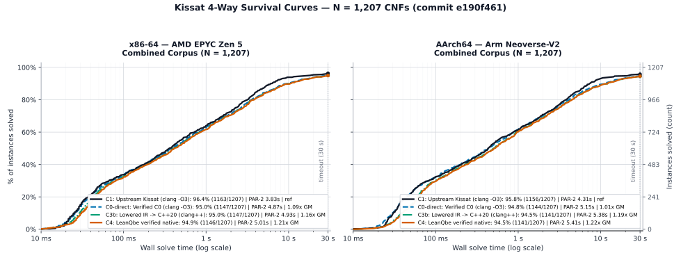

# LeanQbe.T

**LeanQbe.T** is a formally verified optimizing compiler written in Lean 4. It compiles typed
Static Single Assignment (SSA) programs—from extended C0, Lean `LCNF`, Lean `λRC`, WebAssembly,
and Bedrock2 frontends—to native **SysV x86-64** and **AAPCS64 AArch64** assembly (as well as
QBE IL and C++20), with end-to-end semantic preservation proved inside Lean's kernel.

Machine-code correctness proofs compose through **Kraken** ([README.md](README.md)),
which formalizes x86-64 (`Kraken.X64`) and AArch64 (`Kraken.AArch64`) instruction semantics in
separation logic. All verified theorems on `main` depend only on Lean 4's three standard axioms
(`propext`, `Classical.choice`, `Quot.sound`), with zero `sorry`, zero custom trust axioms, and
zero native-code reflection tactics (`native_decide`, `bv_decide`, `ofReduceBool`).

```text
  Frontends                      Typed SSA / Flat IR                     Backends (Kraken ISAs)
  ───────────────────────────    ────────────────────────────────────    ──────────────────────────
  Extended C0 (structs, macros)  ┌──────────────────────────────────┐    ┌────────────────────────┐
  Lean LCNF + C0 runtime & FFI ─▶│ LeanQbe.T PHOAS / First-Order IR │───▶│ SysV x86-64 (+AVX2/512)│
  Lean λRC (LeanLRC)             │  WP separation-logic semantics   │    │ AAPCS64 AArch64        │
  WebAssembly (SFI sandbox)      │  earlyOpt → legal → mid → spill  │    │ QBE IL / C++20 output  │
  Bedrock2 (CFG recovery)        │  → graph-coloring rega → link    │    └────────────────────────┘
                                 └──────────────────────────────────┘
```

---

## Verification Status at a Glance

The table below distinguishes components that are **verified end-to-end on `main`** from active
work in progress. Every verified track has a self-contained audit file under
[LeanQbeTest/T/](LeanQbeTest/T/) restating its exact theorems and Trusted Computing Base (TCB).

| Component | Status on `main` | What Is Proved Inside Lean's Kernel |
| :--- | :--- | :--- |
| **Optimizing Compiler & Linker** | **Verified (dual-arch)** | End-to-end semantic preservation from typed SSA (`Func.wp` / `ModuleOk`) through flat-IR optimization (`MainFlat`), legalization, spilling, register allocation, instruction selection, and acyclic/SCC certificate linking (`LinkedCert`) on x86-64 and AArch64. |
| **Extended C0 Frontend & Logic** | **Verified** | C0 elaboration, SysV LP64 struct/bitfield layout, and symbolic separation-logic stepping tactics (`C0Step`) proved sound against `Func.wp`. |
| **Lean `LCNF` Runtime, Semantics, & FFI** | **Verified (dual-arch)** | Standalone pure-C0 runtime (`rtC0CoreMod` in `LcnfC0Full`, covering 35/38 runtime calls with only 3 FP helpers external) with dual-arch `LinkedCert`s (`rtC0CoreCert` / `rtC0CoreArm64Cert`, `≤ 272 B` stack) and closed machine execution witnesses; two-tier WP semantics (`Sem/H` heap/RC + `Sem/P` pure + `PAdequacy` + `RcCheck` + H→T lowering soundness); zero-axiom C0 FFI bridge (`LcnfC0Ffi`) with closed dual-arch pilot binaries (`pilotX64Cert` / `pilotArm64Cert`) composing `KissatPlain`, `rtC0CoreMod`, and lowered Lean callers. |
| **WebAssembly Sandbox** | **Verified (dual-arch)** | Software Fault Isolation (SFI) host-memory isolation across validated Wasm modules (including bulk-memory ops and mutual recursion) on x86-64 and AArch64. |
| **Bedrock2 CFG Recovery & `Xcap` Interop** | **Verified (dual-arch)** | Witness-checked CFG recovery and contification over structured `BedrockWord` programs; bidirectional `FnSpec` ↔ `Xcap.cptr` bridge for cross-calls with externally verified assembly. |
| **Systems Kernels & LRAT Checker** | **Verified (dual-arch)** | End-to-end machine-code proofs and concrete execution witnesses for RFC 8439 ChaCha20 (row-SIMD `v4i32`), Curve25519 bignum kernels, Union-Find, and an untrusted-bytes DIMACS + binary LRAT UNSAT checker (`lrat_check_bytes`). |
| **Kissat Minimal CDCL (`KissatPlain`)** | **Verified (dual-arch)** | Pure CDCL solver (`plainModule`, entry point `kissat_solve_bytes`) with **dual SAT + UNSAT** soundness, materialized x86-64 & AArch64 `LinkedCert`s (`plainCert`), and concrete machine SAT/UNSAT non-vacuity (`2,048 B` workspace). |
| **Full-Fidelity Kissat (`fidStep12Module`)** | **Source/IR verified; param dual-arch** | Pure-C0 port of Kissat 4.0.4 (`0` externs, `0` exits) with full CDCL + inprocessing: source/IR `ModuleOk`, entry point `kissat_solve_bytes` (wrapping `kissat_solve_bytes_m6`) UNSAT soundness, caller framing, and concrete `Mem 64` UNSAT non-vacuity on `fidStep12Module`. Parameterized dual-arch machine-code theorems (`KissatFidelityParam`) and fail-closed compile guards (`≤ 2,048 B` stack) cover `fidStep9Module`; materialized `LinkedCert`s for `fidStep12Module` are in progress. |
| **Simplified-CNF Exporter (`ExportCnf`)** | **Source/IR verified** | Pure-C0 simplifier and DIMACS serializer (`m6ExportMod`, entry point `kissat_simplify_export_bytes`): grammar round-trip (`parseDimacs outBytes = some cnfOut`), UNSAT soundness (`cnfOut.Unsat → F0.Unsat`), and concrete `Mem 64` non-vacuity. |
| **Bitblaster (`bv_solve_bytes`) & `bv_decide_qbe`** | **Work in progress** | C0 AIG, Tseitin encoder, and core driver (`bitblastModule`, entry point `bv_solve_bytes`, `12/32` `BVP1` opcodes) have WP proofs against Lean's `BVLogicalExpr.Unsat` (currently with an assumed `kissat_solve_bytes` extern contract on `main`). All `32` `BVP1` opcodes + `4` derived ops pass `14,373` differential checks (`0` mismatches), with WP proofs and wiring for the remaining `20` ops in progress. `bv_decide_qbe/` is experimental and currently closes goals via a per-goal axiom (not yet kernel-checked). |
| **Stage-0 Bootstrap (`LeanQbeBootstrap0`)** | **Work in progress** | Syntactic `LinkedCert` (`leanqbe0Cert`, `≤ 1,136 B ≤ 2,048 B` stack) compiling `leanqbe0Mod0` (extracted from `leanqbe0Compile`) and linking it with `rtC0CoreCert` into the closed `0`-extern x86-64 certificate `leanqbe0LinkedCert` (`nX = 64` for `lcnf_panic`), plus separate scalar soundness, codec, and printer checks. Extraction is outside the kernel and no self-hosted semantic fixpoint is proved. |

---

## Quick Start & Contributor Workflow

All Lean builds should use [scripts/build_bounded.sh](scripts/build_bounded.sh), which wraps `lake
build --wfail` in a `systemd` memory cgroup (`MemoryMax=18G`, swap disabled), thread cap (`-j 1`),
and explicit timeout (`-t 600`). By default it rejects bare umbrella targets (`LeanQbe`,
`LeanQbeAmd64`, `LeanQbeArm64`, `LeanQbeTest`, `LeanQbeBootstrap0*`) so iterations target concrete
modules or fine-grained core libraries (`LeanQbeCore`, `LeanQbeAmd64Core`, `LeanQbeArm64Core`,
`LeanQbeCompileGuards`); pass `--allow-broad` when an umbrella build is intentional.

```bash
# 1. Fast preflight (<30s: diff whitespace, ISA import firewall, hub sync, changed-.lean hygiene)
bash scripts/preflight.sh

# 2. Build a specific audit target or core library under bounded memory/threads
scripts/build_bounded.sh -j 1 -m 18G -t 600 -- LeanQbeTest.T.CompilerAuditSpec
scripts/build_bounded.sh -j 2 -m 18G -t 600 -- LeanQbeCore

# 3. Build the native x86-64 and AArch64 CLI drivers
scripts/build_bounded.sh -j 2 -m 18G -t 600 -- leanqbe leanqbe-arm64

# 4. Inspect built-in programs and emit assembly or QBE IL
.lake/build/bin/leanqbe --list
.lake/build/bin/leanqbe uf_bench > /tmp/uf.s
.lake/build/bin/leanqbe --il uf_bench > /tmp/uf.ssa
.lake/build/bin/leanqbe-arm64 uf_bench > /tmp/uf_arm64.s

# 5. Run the full quality gate (build, axiom audit via audit_axioms, headlines, native tests)
timeout 3600 bash scripts/check.sh

# Incremental / docs-only scoped gate (auto-selects docs-only, reverse-dep fast lane, per-ISA, or full)
timeout 120 env CHECK_SCOPE=auto CHECK_BASE=HEAD~1 bash scripts/check.sh
```

**Contributor hygiene rules** (enforced by [scripts/preflight.sh](scripts/preflight.sh) and
[scripts/check.sh](scripts/check.sh)):
- **Standard axioms only:** Active theorems must depend strictly on `[propext, Classical.choice,
  Quot.sound]` (`!isUnsafe`), audited on `.olean` files by `audit_axioms`; zero `sorry`, `admit`,
  non-meta `axiom`, `@[implemented_by]`, `@[extern]`, `trustCompiler`, or native reflection tactics.
- **ISA import firewall & hub sync:** Generic `LeanQbe/T/` modules never import `Kraken.X64` or
  `Kraken.AArch64`, and [LeanQbeAmd64.lean](LeanQbeAmd64.lean) / [LeanQbeArm64.lean](LeanQbeArm64.lean)
  stay strictly disjoint (`python3 -B scripts/check_firewall.py --root . --require-isa`). After
  adding or removing `.lean` modules under `LeanQbe/T/`, synchronize hubs with
  `python3 -B scripts/sync_hubs.py --root .` and verify with `--check --strict`.
- **File, import, & test discipline:** Never use `import all`; keep `.lean` files `< 2,500` lines
  and `<= 100` chars/line; always run test commands under explicit `timeout`.

---

## Architecture & Pipeline

### 1. Typed SSA IR & Weakest-Precondition Semantics
- **Dual Representations:** Programs are written in typed Parametric Higher-Order Abstract Syntax
  (PHOAS: `Prog` / `Func` / `Fn` in [IL.lean](LeanQbe/T/IL.lean)) alongside a first-order de Bruijn
  flat form ([Flat.lean](LeanQbe/T/Flat.lean)).
- **Total-Correctness WP Semantics:** [WP.lean](LeanQbe/T/WP.lean) defines weakest preconditions
  (`wp`, `Func.wp`, `ModuleOk`) over 64-bit byte-addressed memory (`Mem 64`) and separation-logic
  assertions (`⋆`, `region`, `array`, `cell`), guaranteeing explicit postconditions for normal
  returns (`Post`), abnormal exits (`XPost`), and untouched caller memory frames (`R`).

### 2. Frontends & Interoperability
- **Extended C0 ([Frontend/C0.lean](LeanQbe/T/Frontend/C0.lean)):** Elaborates a structured C subset
  with `#include` headers (`c0_header!`), parameterized and variadic `#define` macros, `offsetof`,
  `_Static_assert`, provenance checks, and SysV LP64 struct/bitfield layout, paired with symbolic
  separation-logic stepping tactics ([C0Step.lean](LeanQbe/T/Logic/C0Step.lean)).
- **Lean `LCNF` Frontend, Runtime, Semantics, & FFI ([LeanLCNF/Hub.lean](LeanQbe/T/LeanLCNF/Hub.lean)):**
  - *Standalone C0 Runtime:* [LcnfC0Full.lean](LeanQbe/T/LeanLCNF/LcnfC0Full.lean) implements
    `rtC0CoreMod` in verified pure C0 (heap allocator, reference counting, arbitrary-precision
    `BigNum`, containers, strings), covering `35 / 38` runtime calls with verified SysV x86-64
    ([LcnfC0FullCertX64.lean](LeanQbe/T/Amd64/LcnfC0FullCertX64.lean)) and AAPCS64 AArch64
    ([LcnfC0FullCertArm64.lean](LeanQbe/T/Arm64/LcnfC0FullCertArm64.lean)) `LinkedCert`s
    (`≤ 272 B` stack) and closed concrete machine execution witnesses.
  - *Two-Tier Formal Semantics:* Weakest-precondition semantics at the heap/RC level
    ([Sem/H.lean](LeanQbe/T/LeanLCNF/Sem/H.lean)) and pure value level
    ([Sem/P.lean](LeanQbe/T/LeanLCNF/Sem/P.lean)), connected by Perceus/λRC adequacy
    ([Sem/PAdequacy.lean](LeanQbe/T/LeanLCNF/Sem/PAdequacy.lean)), a decidable ownership checker
    ([Sem/RcCheck.lean](LeanQbe/T/LeanLCNF/Sem/RcCheck.lean)), and H→T lowering soundness
    ([Sem/LowerSound4.lean](LeanQbe/T/LeanLCNF/Sem/LowerSound4.lean)).
  - *Zero-Axiom C0 FFI Bridge:* [LcnfC0Ffi.lean](LeanQbe/T/LeanLCNF/LcnfC0Ffi.lean) lets lowered
    Lean `LCNF` code call verified raw-byte-slice C0 kernels via `ByteArray` or sentineled `Nat`
    carriers without `@[extern]` or custom axioms, demonstrated end-to-end by closed dual-arch
    pilot binaries (`pilotX64Cert` / `pilotArm64Cert`, composing `KissatPlain`, `rtC0CoreMod`, and
    lowered Lean callers without recompiling Kissat or the runtime) in
    [LcnfC0FfiPilotCertX64.lean](LeanQbeTest/T/LcnfC0FfiPilotCertX64.lean) and
    [LcnfC0FfiPilotCertArm64.lean](LeanQbeTest/T/LcnfC0FfiPilotCertArm64.lean).
- **Lean `λRC` ([LeanLRC/Hub.lean](LeanQbe/T/LeanLRC/Hub.lean)):** Compiles Lean's reference-counted
  IR to `LeanQbe.T`.
- **WebAssembly SFI Sandbox ([Wasm/Safety.lean](LeanQbe/T/Wasm/Safety.lean),
  [Wasm/BulkSafety.lean](LeanQbe/T/Wasm/BulkSafety.lean)):** Decodes, validates, and compiles Wasm
  modules (including bulk-memory operations) with proved Software Fault Isolation host-memory
  bounds across arbitrary call graphs (`ModuleSccOk`).
- **Bedrock2 CFG Recovery ([Bedrock2/ToT.lean](LeanQbe/T/Bedrock2/ToT.lean),
  [CfgRecovery.lean](LeanQbe/T/Unified/CfgRecovery.lean),
  [CfgContify.lean](LeanQbe/T/Unified/CfgContify.lean)):** Lowers structured `BedrockWord` programs
  via witness-checked CFG recovery and contification.
- **External Assembly Interop ([Xcap/Bridge.lean](LeanQbe/T/Xcap/Bridge.lean)):** Converts compiled
  `FnSpec` guarantees to and from Certified Assembly Programming (`Xcap.cptr`) code pointers for
  verified cross-calls with externally proved assembly blocks.

### 3. Verified Optimization, Codegen, & Certificate Linking
`LeanQbe.T.compile` ([Main.lean](LeanQbe/T/Main.lean), [Opt.lean](LeanQbe/T/Opt.lean)) runs a
target-parameterized pipeline, mirrored by a direct first-order flat-IR pipeline
([MainFlat.lean](LeanQbe/T/MainFlat.lean), proved equal via `compileFlatFn_eq_compileFn`) and
first-order certificate linking ([MainCertFlat.lean](LeanQbe/T/MainCertFlat.lean)):

1. **Early Optimization (`Func.earlyOpt`):** Constant folding, algebraic simplification, operator
   canonicalization, copy propagation, global value numbering (GVN), branch/switch and boolean
   simplification (`IfOpt`), loop-header and zero-trip peeling (`ZeroPeel` with `u32` IV widening),
   and dead-code / parameter pruning (`DceParam`).
2. **Legalization (`Func.legal`, [Legal.lean](LeanQbe/T/Legal.lean)):** Rewrites constants, widths,
   addressing modes, and instructions to satisfy each target's `LegalTarget` contract.
3. **Mid-Stage & Late Optimization (`Fn.midStage` / `Func.lateOpt`):** Constant-division strength
   reduction, redundant load forwarding, range and bitwidth assumption propagation, dead-load and
   base+offset address-range elimination, loop-invariant code motion (LICM), bottom-tested loop
   rotation, conditional threading, tail duplication, and shared epilogue merging.
4. **Spilling, Register Allocation, & Emission (`Spill.lean`, `Rega.lean`, `Amd64/`, `Arm64/`):**
   Control-flow-preserving spill/reload hinting (with flag-web tracking and base+offset
   rematerialization), graph-coloring GPR/vector allocation, ABI frame lowering, unique `.L` label
   hygiene (`LabelClean`), and target emission into `Kraken.X64` (scalar + AVX2/AVX-512) or
   `Kraken.AArch64`.
5. **Cross-ISA Isolation & Compositional Linking:** Machine-independent modules never import
   `Kraken.X64` or `Kraken.AArch64`, and [LeanQbeAmd64.lean](LeanQbeAmd64.lean) and
   [LeanQbeArm64.lean](LeanQbeArm64.lean) are strictly disjoint (enforced by
   [scripts/check_firewall.py](scripts/check_firewall.py)).
   [MainCertCore.lean](LeanQbe/T/MainCertCore.lean) defines kernel-checked `LinkedCert` artifacts
   that compose across modules, mutual recursion, and least fixed points
   ([MainLink.lean](LeanQbe/T/MainLink.lean), [LinkRec.lean](LeanQbe/T/LinkRec.lean),
   [LinkScc.lean](LeanQbe/T/LinkScc.lean), [LinkLfp.lean](LeanQbe/T/LinkLfp.lean)).

---

## Verified Systems Workloads & Kissat SAT Solver

Alongside smaller verified systems kernels—RFC 8439 **ChaCha20**
([ChaCha.lean](LeanQbe/T/Examples/ChaCha.lean)), **Curve25519** bignum arithmetic
([Bignum.lean](LeanQbe/T/Examples/Bignum.lean)), **Union-Find**
([UnionFind.lean](LeanQbe/T/Examples/UnionFind.lean)), and an untrusted-bytes DIMACS + binary
**LRAT** UNSAT proof checker (`lrat_check_bytes`,
[LratBytes.lean](LeanQbe/T/Examples/LratBytes.lean))—our largest verified application is a pure-C0
port of the **Kissat 4.0.4** CDCL SAT solver (`0` external calls, `0` exit symbols).

### Solver Tracks & Simplified-CNF Exporter

| Track | Module & Entry Point | Soundness Scope | Architecture Verification | Primary Audits |
| :--- | :--- | :--- | :--- | :--- |
| **Full-Fidelity Kissat** | `fidStep12Module` (`kissat_solve_bytes` / `kissat_solve_bytes_m6`) | UNSAT soundness (`r = 20 → cnf.Unsat`) + caller memory framing + concrete `8,192 B` UNSAT non-vacuity | Source/IR `ModuleOk` + WP proofs on `fidStep12Module`; parameterized dual-arch machine-code theorems & fail-closed compile guards (`≤ 2,048 B` stack) on `fidStep9Module` | [KissatFidelityStep12Test.lean](LeanQbeTest/T/KissatFidelityStep12Test.lean), [KissatFidelityParamAuditX64.lean](LeanQbeTest/T/KissatFidelityParamAuditX64.lean), [KissatFidelityParamAuditArm64.lean](LeanQbeTest/T/KissatFidelityParamAuditArm64.lean), [KissatFidelityCompileGuardX64.lean](LeanQbeTest/T/KissatFidelityCompileGuardX64.lean), [KissatFidelityCompileGuardArm64.lean](LeanQbeTest/T/KissatFidelityCompileGuardArm64.lean) |
| **Minimal CDCL (`KissatPlain`)** | `plainModule` (`kissat_solve_bytes`) | **Dual SAT + UNSAT** soundness + framing + concrete SAT & UNSAT non-vacuity (`2,048 B`) | Materialized x86-64 & AArch64 `LinkedCert`s (`plainCert`) with closed concrete machine execution witnesses (pure CDCL, no inprocessing) | [KissatPlainAuditX64.lean](LeanQbeTest/T/KissatPlainAuditX64.lean), [KissatPlainAuditArm64.lean](LeanQbeTest/T/KissatPlainAuditArm64.lean) |
| **Simplified-CNF Exporter (`ExportCnf`)** | `m6ExportMod` (`kissat_simplify_export_bytes`) | DIMACS parse round-trip (`parseDimacs outBytes = some cnfOut`) + UNSAT preservation (`cnfOut.Unsat → F0.Unsat`) + concrete `Mem 64` non-vacuity | Source/IR `ModuleOk` + WP proofs, legal across x86-64 & AArch64 | [ExportCnfEntryTest.lean](LeanQbeTest/T/ExportCnfEntryTest.lean) |

### Building and Running the Native Solver

```bash
# Build certified native x86-64 KissatPlain binary (default fallback while full-fidelity certs are in progress; also supports --arch arm64)
timeout 600 bash bench/kissat/build_solver.sh --module Plain

# Build native Full-Fidelity Kissat binary (requires --allow-uncertified until materialized LinkedCerts land)
timeout 600 bash bench/kissat/build_solver.sh --module KissatFidelity --allow-uncertified

# Run solver verification suites and CLI wrapper checks
timeout 600 bash test/kissat/run.sh
timeout 600 bash test/kissat/test_cli_solver.sh

# Extract standalone C99 source from the verified C0 solver (--target fidelity | plain)
python3 bench/kissat/extract_c0_direct.py --target fidelity --out /tmp/kissat_c0.c
```

### Trusted Computing Base (TCB) & Non-Vacuity

- **Proved Inside Lean (`[propext, Classical.choice, Quot.sound]`):** C0 elaboration, SSA
  optimization, spilling, register allocation, instruction selection, certificate linking, UNSAT
  preservation (and SAT model validity for `KissatPlain`), and concrete non-vacuity witnesses
  confirming that preconditions are satisfiable.
- **Outside Lean (TCB):**
  - The Lean 4 kernel and Kraken operational ISA models (`Kraken.X64`, `Kraken.AArch64`).
  - The `parseDimacs` specification ([LratBytes.lean](LeanQbe/T/Examples/LratBytes.lean)): requires
    variables `< 2^28`, rejects `-0`, missing headers, out-of-range variables, truncated clauses,
    trailing non-whitespace tokens, and `%` trailers; skips `'c'` comment lines from any
    whitespace-delimited position; treats empty clauses as UNSAT and `p cnf 0 0` as empty CNF.
  - The native CLI wrapper ([kissat_cli.c](bench/kissat/kissat_cli.c)) and host assembler/linker
    (`cc`/`as`/`ld`). The CLI enforces `RLIMIT_STACK >= 65536` and brackets input/workspace buffers
    with `PROT_NONE` guard pages.
  - For UNSAT-only certified builds, SAT assignments are checked at runtime by an external model
    checker (`kissat_verify_dimacs_model` in [kissat_verify.h](test/kissat/kissat_verify.h));
    `KissatPlain` proves SAT soundness inside Lean.

### Dual-Architecture Performance Comparison

We benchmark the verified Full-Fidelity Kissat solver (`fidStep12Module`, entry point
`kissat_solve_bytes` / `kissat_solve_bytes_m6`, measured at commit **`e190f461`**) on dedicated
hosts across **1,207 CNF instances** (`140` curated multi-domain benchmarks at 3-rep median +
`1,067` SAT-COMP / SMT-COMP / software-verification benchmarks at 1-rep; `30 s` wall-clock timeout
per instance; `0` OOMs and `0` verdict disagreements across all runs) on both **x86-64** (AMD EPYC
Zen 5) and **AArch64** (Arm Neoverse-V2), comparing four statically linked configurations built
with **Clang 21 (`-O3`)**:

- **`C1`:** Upstream C Kissat 4.0.4 (`clang -O3`).
- **`C0-direct`:** Our verified C0 source extracted to C99 (`clang -O3 -fwrapv
  -fno-strict-aliasing`). Comparing `C0-direct` vs. `C1` isolates algorithmic/data-structure
  differences in the C0 port.
- **`C3b`:** The same C0-lowered `LeanQbe.T` IR printed to C++20 (`PrintCpp`, before LeanQbe
  mid-end passes) and compiled with `clang++ -std=c++20 -O3`. Comparing `C3b` vs. `C0-direct`
  isolates IR-lowering overhead and lost Clang auto-vectorization.
- **`C4`:** **LeanQbe.T** end-to-end verified compilation (inlining policy + mid-end optimization +
  spilling + register allocation + native x86-64 / AArch64 assembly). Comparing `C4` vs. `C3b`
  isolates LeanQbe's verified compiler backend against `clang++ -O3` on identical IR.



Reproduce the SVG directly from the checked-in timing dataset
([kissat_e190f461_survival.csv](bench/kissat/data/kissat_e190f461_survival.csv)), or run and plot
a fresh local 4-way benchmark on your own machine:

```bash
# Regenerate the exact SVG above from the checked-in per-instance timing CSV
python3 bench/kissat/plot_survival.py \
  --csv bench/kissat/data/kissat_e190f461_survival.csv \
  --commit e190f461 -o img/kissat_dual_arch_survival.svg

# Or run a fresh local 4-way benchmark and plot its survival curve
timeout 3600 python3 bench/kissat/run_4way_stage1.py --out-json /tmp/kissat_4way.json
python3 bench/kissat/plot_survival.py --x64 /tmp/kissat_4way.json -o /tmp/kissat_survival.svg
```

| Architecture & Suite (`e190f461`) | Pipeline | Solved (`%`) | SAT / UNSAT | PAR-2 | vs. `C3b` (GM / AM) | vs. `C0-direct` (GM / AM) | vs. `C1` (GM / AM) | Solver `.text` |
| :--- | :--- | :---: | :---: | :---: | :---: | :---: | :---: | :---: |
| **x86-64** (AMD EPYC Zen 5)<br>Combined (`N = 1,207`) | **`C1`** (`clang -O3`) | `1,163` (`96.4%`) | `559 / 604` | `3.83 s` | — | — | `1.00× GM / 1.00× AM` | — |
| | **`C0-direct`** (`clang -O3`) | `1,147` (`95.0%`) | `549 / 598` | `4.87 s` | — | `1.00× GM / 1.00× AM` | `1.09× GM / 1.24× AM` | `358 KB` |
| | **`C3b`** (IR → `clang++ -O3`) | `1,147` (`95.0%`) | `549 / 598` | `4.93 s` | `1.00× GM / 1.00× AM` | `1.06× GM / 1.03× AM` | `1.16× GM / 1.28× AM` | `291 KB` |
| | **`C4`** (`LeanQbe.T` x86-64) | `1,146` (`94.9%`) | `549 / 597` | `5.01 s` | **`1.05× GM / 1.03× AM`** | **`1.11× GM / 1.06× AM`** | **`1.21× GM / 1.32× AM`** | `379 KB` |
| **AArch64** (Arm Neoverse-V2)<br>Combined (`N = 1,207`) | **`C1`** (`clang -O3`) | `1,156` (`95.8%`) | `556 / 600` | `4.31 s` | — | — | `1.00× GM / 1.00× AM` | — |
| | **`C0-direct`** (`clang -O3`) | `1,144` (`94.8%`) | `546 / 598` | `5.15 s` | — | `1.00× GM / 1.00× AM` | `1.01× GM / 1.15× AM` | `371 KB` |
| | **`C3b`** (IR → `clang++ -O3`) | `1,141` (`94.5%`) | `545 / 596` | `5.38 s` | `1.00× GM / 1.00× AM` | `1.17× GM / 1.08× AM` | `1.19× GM / 1.25× AM` | `248 KB` |
| | **`C4`** (`LeanQbe.T` AArch64) | `1,141` (`94.5%`) | `545 / 596` | `5.41 s` | **`1.03× GM / 1.01× AM`** | **`1.20× GM / 1.10× AM`** | **`1.22× GM / 1.26× AM`** | `339 KB` |

*Metrics: PAR-2 penalizes timeouts at `2 × 30 s = 60 s`. Every ratio is explicitly labeled as
either **GM** (pairwise wall-time geometric mean over commonly solved instances with a `20 ms`
floor) or **AM** (arithmetic-mean total wall-time ratio over commonly solved instances). On the
`140`-CNF curated subset alone, all four x86-64 pipelines solve `136 / 140` (`97.1%`) with
`C4 / C3b = 1.03× GM` (`1.03× AM`), and AArch64 `C1`, `C3b`, and `C4` solve `135 / 140` (`96.4%`,
`C0-direct`: `136 / 140`) with `C4 / C3b = 1.03× GM` (`1.01× AM`). Caveat: `C4` binaries here are
emitted by the verified compiler pipeline from `fidStep12Module` at commit `e190f461`; materialized
`LinkedCert`s for `fidStep12Module` are not yet built on `main`.*

**Reading the results honestly:**
- **Verified backend (`C4` vs. `C3b`):** Across `1,207` instances, LeanQbe's verified backend runs
  within **`3–5%` GM (`1–3%` AM)** of `clang++ -O3` on the exact same lowered IR on both x86-64
  and AArch64. On AArch64, `C4`'s solver `.text` (`339 KB`) is `8.5%` smaller than `C0-direct`
  (`371 KB`).
- **IR lowering & SIMD gap (`C3b` vs. `C0-direct`):** On AArch64, `clang -O3` auto-vectorizes C0
  initialization loops with 128-bit NEON instructions, driving most of the `1.17× GM` (`1.08× AM`)
  gap on short (`< 200 ms`) instances; on longer (`>= 1 s`) runs across the `N = 1,207` corpus,
  `C4 / C0-direct` narrows to `1.07× GM` (`1.06× AM`) on x86-64 and `1.11× GM` (`1.09× AM`) on
  AArch64.
- **UNSAT vs. SAT breakdown:** On **UNSAT (`N = 638`)**, all four pipelines are nearly overlaid
  (`C1` `604/638` `94.7%` vs. `C4` `597/638` `93.6%` on x86-64; `600/638` `94.0%` vs. `596/638`
  `93.4%` on AArch64). Most of the remaining solved-count separation vs. upstream Kissat (`C1`) sits
  on **SAT (`N = 569`)** in the `1–10 s` region (`C1` `559/569` `98.2%` vs. `C4` `549/569` `96.5%`
  on x86-64; `556/569` `97.7%` vs. `545/569` `95.8%` on AArch64).

---

## Work in Progress

### Verified Bitblaster (`bv_solve_bytes`) & Experimental `bv_decide_qbe`
- **What is verified on `main`:** [Bitblast/Src/Full.lean](LeanQbe/T/Examples/Bitblast/Src/Full.lean)
  and [Bitblast/Proof/Full.lean](LeanQbe/T/Examples/Bitblast/Proof/Full.lean) verify a C0
  And-Inverter Graph (AIG) builder, Tseitin CNF encoder, and core driver (`bitblastModule`, entry
  point `bv_solve_bytes`, `12 / 32` `BVP1` opcodes: variables, constants, Boolean gates, `not`,
  `eq`, `getLsbD`, `ite`) directly against Lean's upstream `Std.Tactic.BVDecide.BVLogicalExpr.Unsat`
  with zero custom axioms ([BitblastProofTest.lean](LeanQbeTest/T/BitblastProofTest.lean)). On
  `main`, the SAT solver call (`kissat_solve_bytes`) is still an assumed extern hypothesis in the
  bitblaster spec.
- **What is in progress:** All `32` `BVP1` opcodes + `4` derived ops are implemented in C0 and pass
  `14,373` differential checks against upstream `BVDecide` with `0` mismatches, while `Func.wp`
  proofs and wiring into `Src/Full.lean` for the remaining `20` data/arithmetic opcodes (bitwise
  ops, addition, multiplication, shifts, rotates, unsigned division/remainder, `clz`, `cpop`) are
  still in progress.
- **Important caveat for `bv_decide_qbe/`:** The prototype tactic in
  [bv_decide_qbe/BvDecideQbe/Prover.lean](bv_decide_qbe/BvDecideQbe/Prover.lean) is **not yet
  kernel-checked**. It currently runs upstream's bitblaster with a native Kissat binary and closes
  the Lean goal by adding a per-goal axiom, rather than discharging the goal through the verified C0
  bitblaster and a `LinkedCert`.

### Stage-0 Bootstrapping (`LeanQbeBootstrap0`)
The bootstrapping workstream ([Mod0.lean](LeanQbe/T/Bootstrap0/Mod0.lean),
[Cert.lean](LeanQbe/T/Bootstrap0/Cert.lean), [Sound0.lean](LeanQbe/T/Bootstrap0/Sound0.lean))
explores compiling a Lean-extracted Stage-0 compiler (`leanqbe0Compile`) using `LeanQbe.T`:
- **What is checked:** `Fn.Wf`, call-graph acyclicity, and signature legality for `leanqbe0Mod0`,
  plus a SysV x86-64 `LinkedCert` (`leanqbe0Cert`, stack bounds `≤ 1,136 B ≤ 2,048 B`) parameterized
  by the verified `rtC0CoreAllExt` stack bounds (`≤ 272 B` across `rtC0CoreMod`) and linked onto
  `rtC0CoreCert` to form the closed `0`-extern certificate `leanqbe0LinkedCert` (`nX = 64` for
  single exit `lcnf_panic`). Separately, `Sound0`, `Codec0`, and `PrintDir0` check scalar semantic
  soundness on guarded inputs, binary codec round-trips, and assembly printer parity
  ([Bootstrap0Audit.lean](LeanQbeBootstrap0Test/Bootstrap0Audit.lean)).
- **Explicit non-claims:** `leanqbe0Cert` / `leanqbe0LinkedCert` provide syntactic IR-to-x86-64
  compilation certification only for `leanqbe0Mod0` (not `ModuleOk` / `Eventually` semantic
  equivalence for the compiled binary), extraction (`lcnf_of_lean!` / `splice_lcnf_tflat!`) is
  outside the proof kernel, `lcnf_panic` remains an unmodeled exit symbol (`nX = 64`), and no
  self-hosted fixpoint has been proved.

---

## Verification & Audit Index

Every major workstream provides standalone audit files under [LeanQbeTest/T/](LeanQbeTest/T/) or
[LeanQbeBootstrap0Test/](LeanQbeBootstrap0Test/):

| Workstream | Core Modules | Audit & Parity Files (Core / x86-64 / AArch64) |
| :--- | :--- | :--- |
| **Compiler Core & Linking** | [Main.lean](LeanQbe/T/Main.lean), [MainCertCore.lean](LeanQbe/T/MainCertCore.lean), [LinkScc.lean](LeanQbe/T/LinkScc.lean), [LinkRec.lean](LeanQbe/T/LinkRec.lean) | [CompilerAuditSpec.lean](LeanQbeTest/T/CompilerAuditSpec.lean) / [CompilerAuditX64.lean](LeanQbeTest/T/CompilerAuditX64.lean) / [CompilerAuditArm64.lean](LeanQbeTest/T/CompilerAuditArm64.lean) |
| **Flat-IR Pipeline & Certs** | [MainFlat.lean](LeanQbe/T/MainFlat.lean), [MainFlatLemmas.lean](LeanQbe/T/MainFlatLemmas.lean), [MainCertFlat.lean](LeanQbe/T/MainCertFlat.lean) | [MainFlatParityTest.lean](LeanQbeTest/T/MainFlatParityTest.lean) / [MainFlatParityArm64Test.lean](LeanQbeTest/T/MainFlatParityArm64Test.lean) |
| **Bedrock2 CFG Recovery** | [CfgRecovery.lean](LeanQbe/T/Unified/CfgRecovery.lean), [CfgContify.lean](LeanQbe/T/Unified/CfgContify.lean), [CfgRecoveryBridge.lean](LeanQbe/T/Unified/CfgRecoveryBridge.lean) | [BedrockCfgRecoveryTest.lean](LeanQbeTest/T/BedrockCfgRecoveryTest.lean) |
| **XCAP Assembly Interop** | [Xcap/Core.lean](LeanQbe/T/Xcap/Core.lean), [Xcap/Bridge.lean](LeanQbe/T/Xcap/Bridge.lean) | [XcapBridgeTest.lean](LeanQbeTest/T/XcapBridgeTest.lean) / [XcapBridgeX64Test.lean](LeanQbeTest/T/XcapBridgeX64Test.lean) / [XcapBridgeArm64Test.lean](LeanQbeTest/T/XcapBridgeArm64Test.lean) |
| **C0 Frontend & Logic** | [Frontend/C0.lean](LeanQbe/T/Frontend/C0.lean), [Logic/C0Step.lean](LeanQbe/T/Logic/C0Step.lean) | [C0LogicAudit.lean](LeanQbeTest/T/C0LogicAudit.lean), [C0ExtensionsTest.lean](LeanQbeTest/T/C0ExtensionsTest.lean) |
| **Lean `LCNF` Runtime, Semantics, & FFI** | [LeanLCNF/Hub.lean](LeanQbe/T/LeanLCNF/Hub.lean), [LcnfC0Full.lean](LeanQbe/T/LeanLCNF/LcnfC0Full.lean), [Sem/PAdequacy.lean](LeanQbe/T/LeanLCNF/Sem/PAdequacy.lean), [LcnfC0Ffi.lean](LeanQbe/T/LeanLCNF/LcnfC0Ffi.lean) | [LcnfAudit.lean](LeanQbeTest/T/LcnfAudit.lean), [LcnfC0FullTest.lean](LeanQbeTest/T/LcnfC0FullTest.lean), [LcnfSemHTest.lean](LeanQbeTest/T/LcnfSemHTest.lean), [LcnfSemPTest.lean](LeanQbeTest/T/LcnfSemPTest.lean), [LcnfLowerSoundTest.lean](LeanQbeTest/T/LcnfLowerSoundTest.lean) / [LcnfC0FullCertTest.lean](LeanQbeTest/T/LcnfC0FullCertTest.lean), [LcnfC0FfiPilotCertX64.lean](LeanQbeTest/T/LcnfC0FfiPilotCertX64.lean) / [LcnfC0FullCertArm64Test.lean](LeanQbeTest/T/LcnfC0FullCertArm64Test.lean), [LcnfC0FfiPilotCertArm64.lean](LeanQbeTest/T/LcnfC0FfiPilotCertArm64.lean) |
| **ChaCha20, Curve25519, Union-Find** | [ChaCha.lean](LeanQbe/T/Examples/ChaCha.lean), [Bignum.lean](LeanQbe/T/Examples/Bignum.lean), [UnionFind.lean](LeanQbe/T/Examples/UnionFind.lean) | [WorkloadsAuditSpec.lean](LeanQbeTest/T/WorkloadsAuditSpec.lean) / [WorkloadsAuditX64.lean](LeanQbeTest/T/WorkloadsAuditX64.lean) / [WorkloadsAuditArm64.lean](LeanQbeTest/T/WorkloadsAuditArm64.lean) |
| **LRAT Proof Checker (`lrat_check_bytes`)** | [LratBytes.lean](LeanQbe/T/Examples/LratBytes.lean), [LratBytesSpec.lean](LeanQbe/T/Examples/LratBytesSpec.lean) | [LratAuditSpec.lean](LeanQbeTest/T/LratAuditSpec.lean) / [LratAuditX64.lean](LeanQbeTest/T/LratAuditX64.lean) / [LratAuditArm64.lean](LeanQbeTest/T/LratAuditArm64.lean) |
| **WebAssembly Sandbox** | [Wasm/Safety.lean](LeanQbe/T/Wasm/Safety.lean), [Wasm/BulkSafety.lean](LeanQbe/T/Wasm/BulkSafety.lean) | [WasmAuditSpec.lean](LeanQbeTest/T/WasmAuditSpec.lean) / [WasmAuditX64.lean](LeanQbeTest/T/WasmAuditX64.lean) / [WasmAuditArm64.lean](LeanQbeTest/T/WasmAuditArm64.lean) |
| **Kissat Full-Fidelity (`kissat_solve_bytes`)** | [FidelityHub.lean](LeanQbe/T/Examples/Kissat/FidelityHub.lean), [FullFidelityAssemblyStep12.lean](LeanQbe/T/Examples/Kissat/FullFidelityAssemblyStep12.lean), [FullFidelityAssemblyStep9.lean](LeanQbe/T/Examples/Kissat/FullFidelityAssemblyStep9.lean) | [KissatFidelityStep12Test.lean](LeanQbeTest/T/KissatFidelityStep12Test.lean), [KissatFidelityAuditSpec.lean](LeanQbeTest/T/KissatFidelityAuditSpec.lean) / [KissatFidelityParamAuditX64.lean](LeanQbeTest/T/KissatFidelityParamAuditX64.lean) / [KissatFidelityParamAuditArm64.lean](LeanQbeTest/T/KissatFidelityParamAuditArm64.lean) |
| **Kissat Minimal CDCL (`KissatPlain`)** | [Plain.lean](LeanQbe/T/Examples/Kissat/Plain.lean) | [KissatPlainAuditX64.lean](LeanQbeTest/T/KissatPlainAuditX64.lean) / [KissatPlainAuditArm64.lean](LeanQbeTest/T/KissatPlainAuditArm64.lean) |
| **Simplified-CNF Exporter (`kissat_simplify_export_bytes`)** | [ExportCnfEntry.lean](LeanQbe/T/Examples/Kissat/ExportCnfEntry.lean), [ExportCnfEntryProof.lean](LeanQbe/T/Examples/Kissat/ExportCnfEntryProof.lean) | [ExportCnfEntryTest.lean](LeanQbeTest/T/ExportCnfEntryTest.lean) |
| **Bitblaster (`bv_solve_bytes`, WIP)** | [Bitblast/Src/Full.lean](LeanQbe/T/Examples/Bitblast/Src/Full.lean), [Bitblast/Proof/Full.lean](LeanQbe/T/Examples/Bitblast/Proof/Full.lean) | [BitblastProofTest.lean](LeanQbeTest/T/BitblastProofTest.lean) |
| **Stage-0 Bootstrap (`leanqbe0Compile`, WIP)** | [Mod0.lean](LeanQbe/T/Bootstrap0/Mod0.lean), [Cert.lean](LeanQbe/T/Bootstrap0/Cert.lean), [Sound0.lean](LeanQbe/T/Bootstrap0/Sound0.lean) | [Bootstrap0Audit.lean](LeanQbeBootstrap0Test/Bootstrap0Audit.lean), [Sound0Test.lean](LeanQbeBootstrap0Test/Sound0Test.lean), [Codec0Test.lean](LeanQbeBootstrap0Test/Codec0Test.lean), [PrintDir0Test.lean](LeanQbeBootstrap0Test/PrintDir0Test.lean), [StageCTest.lean](LeanQbeBootstrap0Test/StageCTest.lean) |

### Building Individual Audit Targets

```bash
scripts/build_bounded.sh -j 2 -m 18G -t 1200 -- \
  LeanQbeTest.T.CompilerAuditSpec LeanQbeTest.T.CompilerAuditX64 LeanQbeTest.T.CompilerAuditArm64 \
  LeanQbeTest.T.WorkloadsAuditSpec LeanQbeTest.T.WorkloadsAuditX64 LeanQbeTest.T.WorkloadsAuditArm64 \
  LeanQbeTest.T.LratAuditSpec LeanQbeTest.T.LratAuditX64 LeanQbeTest.T.LratAuditArm64 \
  LeanQbeTest.T.WasmAuditSpec LeanQbeTest.T.WasmAuditX64 LeanQbeTest.T.WasmAuditArm64 \
  LeanQbeTest.T.C0LogicAudit LeanQbeTest.T.LcnfAudit LeanQbeTest.T.LcnfC0FullTest \
  LeanQbeTest.T.LcnfC0FullCertTest LeanQbeTest.T.LcnfC0FullCertArm64Test \
  LeanQbeTest.T.MainFlatParityTest LeanQbeTest.T.XcapBridgeTest \
  LeanQbeTest.T.KissatFidelityStep12Test LeanQbeTest.T.KissatFidelityAuditSpec \
  LeanQbeTest.T.KissatFidelityParamAuditX64 LeanQbeTest.T.KissatFidelityParamAuditArm64 \
  LeanQbeTest.T.KissatFidelityCompileGuardX64 LeanQbeTest.T.KissatFidelityCompileGuardArm64 \
  LeanQbeTest.T.KissatPlainAuditX64 LeanQbeTest.T.KissatPlainAuditArm64 \
  LeanQbeTest.T.ExportCnfEntryTest LeanQbeTest.T.BitblastProofTest

# Optional: Stage-0 bootstrap audits (requires --allow-broad for the umbrella library)
scripts/build_bounded.sh -j 2 -m 18G -t 900 --allow-broad -- LeanQbeBootstrap0Test
```

### Native Differential Test Suites

| Suite | Coverage |
| :--- | :--- |
| [test/run.sh](test/run.sh) | Core x86-64 scalar/litmus binaries, `PrintQbe` cross-compilation, and C0/LRC/Kissat integration |
| [test/arm64/run.sh](test/arm64/run.sh) | AAPCS64 AArch64 assembly vs. stock QBE under `qemu-aarch64` |
| [test/c0/run.sh](test/c0/run.sh) | Positive/negative C0 probes, SysV struct/bitfield layout, and host C differential tests |
| [test/lcnf/run.sh](test/lcnf/run.sh), [test/lcnf/run_c0rt.sh](test/lcnf/run_c0rt.sh), [test/lrc/run.sh](test/lrc/run.sh) | `LeanLCNF` / `LeanLRC` reference Lean executables vs. C++20, x86-64, and AArch64 (including compiled `rtC0CoreMod`) |
| [test/cpp/run.sh](test/cpp/run.sh) | C++20 standalone compilation and trap checks under `g++` and `clang++` ASan/UBSan |
| [test/t_bignum/run.sh](test/t_bignum/run.sh), [test/t_chacha/run.sh](test/t_chacha/run.sh) | Differential x86-64 & AArch64 tests for Curve25519 arithmetic and RFC 8439 ChaCha20 |
| [test/t_lrat/run.sh](test/t_lrat/run.sh), [test/t_qbe/run.sh](test/t_qbe/run.sh) | C++20 ASan/UBSan checks for `lrat_check_bytes` and stock QBE IL emission |
| [test/kissat/run.sh](test/kissat/run.sh), [test/kissat/test_cli_solver.sh](test/kissat/test_cli_solver.sh) | Native Kissat solver verification against SAT witnesses and DRAT/LRAT UNSAT checks |
| [test/bootstrap0/run_stage_c_native.sh](test/bootstrap0/run_stage_c_native.sh) | Stage-0 native binary emission & differential execution |

---

## Repository Layout

| Path | Contents |
| :--- | :--- |
| [LeanQbe.lean](LeanQbe.lean), [LeanQbeAmd64.lean](LeanQbeAmd64.lean), [LeanQbeArm64.lean](LeanQbeArm64.lean) | Top-level library roots with strict x86-64 / AArch64 import isolation |
| [Main.lean](Main.lean), [MainArm64.lean](MainArm64.lean), [Driver.lean](LeanQbe/T/Driver.lean) | Native CLI executables (`leanqbe`, `leanqbe-arm64`) |
| `LeanQbe/T/` | Core SSA IR (`IL`, `Flat`), WP semantics (`WP`), PHOAS & flat-IR optimizers (`Opt`, `OptFlat*`, `Main`, `MainFlat`), spilling (`Spill`), register allocation (`Rega`), certificates (`MainCert*`), linking (`MainLink*`, `LinkRec`, `LinkScc`, `LinkLfp`), QBE/C++20 printers (`PrintQbe`, `PrintCpp`) |
| `LeanQbe/T/Amd64/` & `LeanQbe/T/Arm64/` | SysV x86-64 and AAPCS64 AArch64 target contracts, instruction selection, frame lowering, certificates, and assembly printers |
| `LeanQbe/T/Frontend/C0/`, `LeanLCNF/`, `LeanLRC/`, `Wasm/`, `Bedrock2/`, `BedrockWord/` | Source language frontends, SFI Wasm compiler, `LCNF` two-tier semantics (`Sem/`), pure-C0 runtime (`LcnfC0Full`), and zero-axiom C0 FFI (`LcnfC0Ffi`) |
| `LeanQbe/T/Unified/` & `LeanQbe/T/Xcap/` | Bedrock2 CFG recovery & contification (`CfgRecovery`, `CfgContify`) and bidirectional `FnSpec` ↔ `Xcap.cptr` assembly interop |
| `LeanQbe/T/Logic/` | Separation-logic slab/tree automation, symbolic C0 stepper (`C0Step`), and legality combinators |
| `LeanQbe/T/Examples/` | Verified `ChaCha20`, `Curve25519` bignum, `UnionFind`, `LratBytes`, `Kissat` (`fidStep12Module`, `Plain`, `ExportCnf`), and WIP `Bitblast` |
| `LeanQbe/T/Bootstrap0/` & `bv_decide_qbe/` | Stage-0 bootstrapping workstream (`leanqbe0Compile`) and experimental `bv_decide_qbe` tactic prototype |
| `Kraken/` | Formalized x86-64 and AArch64 ISA semantics and separation-logic framework ([README.md](README.md)) |
| `LeanQbeTest/T/`, `LeanQbeBootstrap0Test/` | Self-contained audit specifications, parity/unit tests, and dual-arch compile guards |
| `scripts/`, `test/`, `bench/` | [build_bounded.sh](scripts/build_bounded.sh), [preflight.sh](scripts/preflight.sh), [check.sh](scripts/check.sh), native differential test suites, and Kissat benchmark harnesses ([build_solver.sh](bench/kissat/build_solver.sh), [run_4way_stage1.py](bench/kissat/run_4way_stage1.py), [compare_4way_min.py](bench/kissat/compare_4way_min.py)) |
